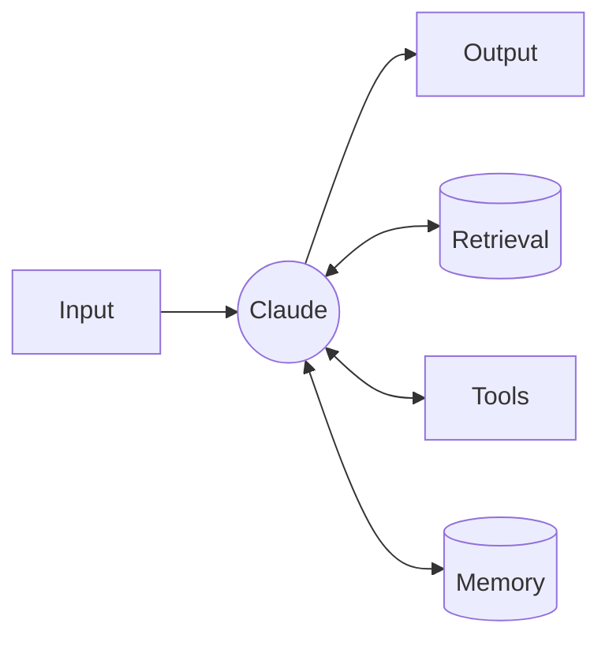
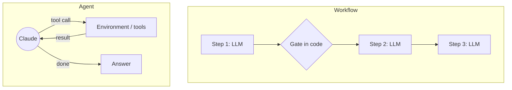
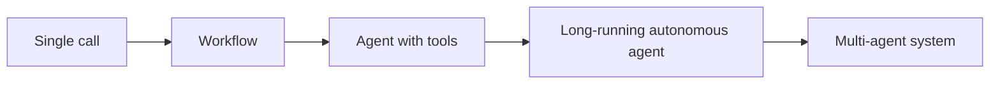

# 01. Foundations: from one call to an agent

## The augmented LLM

The building block of every agentic system is a model call **augmented** with
three things:

- **retrieval**: the data it needs, put in its context (documents, records);
- **tools**: functions it can ask your code to run;
- **memory**: what it should remember across turns or sessions.

Example 01 is the smallest useful version: one call, a precise system prompt,
and a JSON schema (`output_config.format`) that guarantees a parseable answer.

## Workflow or agent?

Both are "agentic systems". The difference is **who decides the next step**.

| | Workflow | Agent |
|---|---|---|
| Control flow | Your code, fixed in advance | The model, at run time |
| Number of steps | Known | Unknown, bounded by limits |
| Predictability | High | Lower |
| Cost and latency | Predictable | Variable, usually higher |
| Best for | Well-defined, repeatable tasks | Open-ended tasks hard to script |
| Examples here | 03 to 07 | 02, 08, 09, 12 |

## Should you build an agent at all?

Check four criteria. If one answer is "no", stay at a simpler level.

1. **Complexity**: is the task multi-step and hard to specify in advance?
   "Turn this bug report into a fix" is; "extract the invoice total" is not.
2. **Value**: does the outcome justify more tokens and more latency?
3. **Viability**: can Claude actually do this kind of task well? Try it by hand.
4. **Cost of error**: can mistakes be caught and undone (tests, review,
   approval, rollback)? If an error is irreversible and invisible, add a human.

## The autonomy ladder

Each step to the right buys flexibility and pays in cost, latency, and
difficulty to test. Climb one step at a time, and only when an eval shows the
current step is not good enough.

## What an agent is made of

Whatever the framework, an agent has the same parts:

| Part | Question it answers | In this repo |
|---|---|---|
| Model | Who thinks? | `MODEL`, `FAST_MODEL` in `config` |
| Instructions | What is the job, what are the rules? | `SYSTEM` prompts |
| Tools | What can it do in the world? | `bookshop` tool definitions |
| Loop | How does it iterate? | `ex02`, `loop.py`, `loop.ts`, `Agent.kt` |
| Context strategy | What does it see at each step? | `ex09` |
| Memory | What persists between sessions? | `ex09` `MemoryNotes` |
| Guardrails | What can it never do? | `ex08`, Claude Code hooks |
| Stopping rules | When does it stop? | turn limit, budget, final answer |
| Evals | How do we know it works? | `ex10` |

Next: [02. Agent types](02-agent-types.md).
