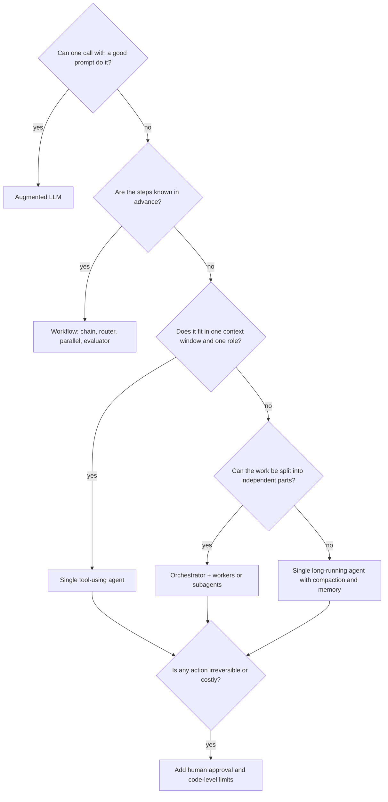

# 02. Agent types: a complete map

"Agent" covers very different things. This chapter classifies them along six
independent axes. Any real agent is a combination: for example, a *coding*
agent (domain) running *headless* (interaction) as a *subagent* (role) on
*self-hosted* infrastructure (hosting) with *session memory* (state) and
*supervised* autonomy.

## Axis 1. Level of autonomy

| Type | Who decides the steps | Typical stop | Example in this repo |
|---|---|---|---|
| **Augmented LLM** | Nobody: one call | Single answer | `ex01` triage |
| **Workflow** (prompt chain, router, pipeline) | Your code | End of the script | `ex03` to `ex07` |
| **Tool-using agent** | The model, inside a bounded loop | Answer without tool call, or turn limit | `ex02`, `ex08` |
| **Autonomous long-running agent** | The model, over minutes or hours, with its own plan, files and checkpoints | Goal reached, budget spent, or human interrupt | `ex12` (Agent SDK), Claude Code, Managed Agents |

Rule of thumb: the more autonomy, the more you need guardrails (chapter 11)
and evals (chapter 12).

## Axis 2. Mode of interaction

| Type | Description | When to use | How it starts |
|---|---|---|---|
| **Conversational assistant** | A human sends each message, the agent answers, possibly using tools in between | Support chat, copilots, internal helpdesk | A chat UI, Slack, `claude` in a terminal |
| **Task agent** | Receives one goal and works until it is done, then reports | "Fix this bug", "write the release notes" | `claude -p "..."`, `query(prompt)` in the SDK, an API call |
| **Background (ambient) agent** | Wakes up on an event without a human prompting it | Triage every new ticket, review every PR, nightly reports | Webhook, CI pipeline, cron, scheduled routine |
| **Batch agent** | Runs the same task over many inputs, results collected later | Classify 10 000 tickets, enrich a catalog | Message Batches API (half price, asynchronous) |
| **Human-in-the-loop agent** | Works autonomously but pauses for approval on risky actions | Refunds, deployments, emails sent to customers | Any of the above, plus an approval step (`ex08`) |

## Axis 3. Role inside a system

When several model calls cooperate, each one plays a role.

| Role | Job | Model choice | Example |
|---|---|---|---|
| **Router / classifier** | Decides where an input should go | Small, fast model | `ex04` |
| **Planner / orchestrator / lead** | Breaks a goal into sub-tasks, delegates, synthesises | Most capable model | `ex06` |
| **Worker** | Executes one narrow sub-task with a focused context | Small or medium model | `ex06` workers |
| **Subagent** | A full agent (own prompt, tools, context window) called by a parent agent as if it were a tool | Depends on the task | `ex12` `test-reviewer`, `claude-code/.claude/agents` |
| **Evaluator / critic** | Grades another model's output against a rubric and gives feedback | Different model from the writer | `ex07` |
| **Judge** | Scores outputs offline for evals | Capable model, explicit rubric | `ex10` `judge_reply` |
| **Guard** | Checks inputs or outputs for policy violations | Small model, or code | `ex05` sectioning checks |
| **Summariser / compactor** | Compresses history to keep context small | Small model | `ex09` |

## Axis 4. Domain and capabilities

| Type | What it does | Key tools | Main risks |
|---|---|---|---|
| **Coding agent** | Reads, edits, runs and tests code | File read/edit, shell, tests, git | Destructive commands, secrets, wrong edits |
| **Research agent** | Searches, reads and synthesises sources | Web search, web fetch, citations | Prompt injection from pages, hallucinated sources |
| **Data / analysis agent** | Runs code on data, builds charts and reports | Code execution sandbox, files | Wrong numbers presented confidently |
| **Computer-use / browser agent** | Operates a GUI through screenshots, clicks and typing | Computer use tool, browser automation | Acting on the wrong screen, injected page content |
| **Customer-facing agent** | Answers customers, takes actions on their account | Business APIs (orders, refunds) | Fraud, policy breaches, tone |
| **Operations agent (SRE, IT)** | Investigates incidents, runs runbooks | Logs, metrics, cloud CLIs | Changes to production |
| **Personal assistant** | Email, calendar, documents, tasks | MCP servers for each service | Sending on your behalf, privacy |

## Axis 5. Where it runs (hosting)

| Type | Who runs the loop | Who runs the tools | Product |
|---|---|---|---|
| **Local agent** | A process on your machine | Your machine | Claude Code CLI, IDE extensions, desktop app |
| **Self-hosted service** | Your server | Your server | Messages API + your loop, Tool Runner, Agent SDK |
| **Managed agent** | Anthropic | An Anthropic-hosted sandbox per session (plus your own tools if you want) | Claude Managed Agents |
| **Embedded agent** | A platform | The platform | Claude in Slack, GitHub Action, claude.ai |

## Axis 6. State and memory

| Type | Remembers | How |
|---|---|---|
| **Stateless** | Nothing between calls | Each request carries everything (`ex01`) |
| **Session state** | The current conversation | Message history sent at each turn, compaction when it grows (`ex09` `SupportSession`) |
| **Long-term memory** | Facts across sessions | A store the agent reads and writes through tools (`ex09` `MemoryNotes`), the API memory tool, `CLAUDE.md` files in Claude Code, memory stores in Managed Agents |
| **Workspace state** | Files it produced | A working directory or sandbox (Agent SDK, Managed Agents) |

## Choosing a type: a decision tree

Next: [03. Every way to create, launch and use an agent](03-build-and-run.md).
