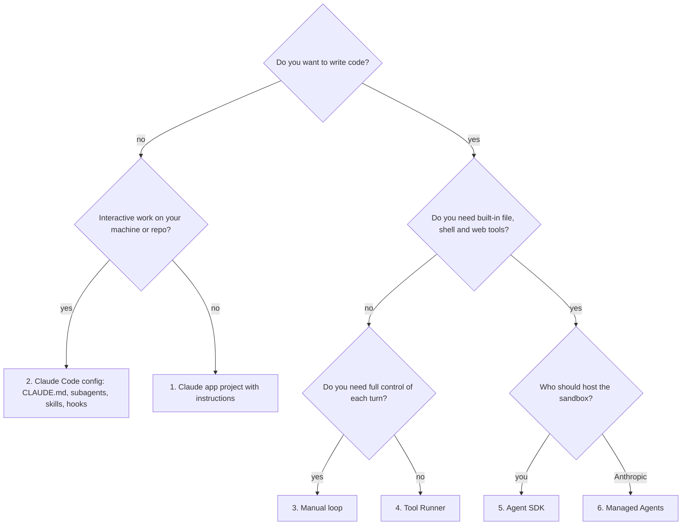

# 03. Every way to create, launch and use a Claude agent

Chapter 02 said *what kinds* of agents exist. This one says *how*: the eight
ways to build one, the ways to start it, and the ways to put it in front of
users or systems. For each, you get what it is, when to choose it, a minimal
snippet, and where it lives in this repo.

## Part 1. Eight ways to create an agent

Two questions separate the options: **who writes the loop** (the
request, run tools, repeat cycle) and **who hosts it**.

| # | Approach | You write | Loop provided by | Hosted by | Built-in tools |
|---|---|---|---|---|---|
| 1 | Prompt-only agent in Claude apps (Projects, custom instructions) | Instructions and files | claude.ai | Anthropic | Apps' own (search, files, connectors) |
| 2 | Claude Code configuration (no code) | Markdown and JSON files | Claude Code | Your machine or CI | Read, Edit, Bash, Grep, web, MCP... |
| 3 | Messages API, manual loop | Everything | You | You | Only yours, plus server tools |
| 4 | Messages API, Tool Runner | Tool functions | The SDK (`tool_runner`) | You | Only yours, plus server tools |
| 5 | Claude Agent SDK | A prompt and options | The Claude Code harness, as a library | You | Claude Code's tools, MCP, subagents |
| 6 | Claude Managed Agents | An agent config | Anthropic | Anthropic (a sandbox per session) | Bash, files, code, web, MCP, skills |
| 7 | MCP server (extends any of the above) | Tools, resources, prompts | The client agent | You | n/a |
| 8 | Third-party frameworks | Framework code | The framework | You | Framework's own |

How to choose:



Whatever you pick, expose your business capabilities as an **MCP server**
(option 7) so every agent can reuse them.

### 1. Prompt-only agent in a Claude app

A Project in claude.ai with instructions, knowledge files and connectors
(Gmail, Drive, your MCP servers) is already an agent: Claude decides when to
search, read or call a connector. No code, no hosting.

- **Choose it for**: personal or team assistants, prototypes of a prompt.
- **Limits**: no control of the loop, no automated tests, human in the chat.

### 2. Claude Code configuration (no code)

Claude Code is a general agent you specialise with files in your repository.
See [chapter 09](09-claude-code.md) and the [`claude-code/`](../../claude-code) folder.

| File | Creates |
|---|---|
| `CLAUDE.md` | Project memory loaded in every session |
| `.claude/agents/<name>.md` | A **subagent**: own prompt, tools, model, context window |
| `.claude/skills/<name>/SKILL.md` | A **skill**: instructions and scripts loaded on demand |
| `.claude/settings.json` | Permissions and **hooks** (code run before or after tool calls) |
| `.mcp.json` | MCP servers available to the project |
| A plugin | All of the above, packaged and shareable |

A subagent in ten lines:

```markdown
---
name: code-reviewer
description: Reviews a diff for bugs and missing tests. Use it proactively before committing.
tools: Read, Grep, Glob, Bash
model: sonnet
---
You are a senior reviewer. Run `git diff`, report findings as file:line | severity | fix.
```

- **Choose it for**: coding, repo automation, ops runbooks, anything that
  lives next to files.

### 3. Messages API, manual loop

You call `POST /v1/messages` with `tools`, run what Claude asks for, send back
`tool_result` blocks, and repeat until `stop_reason` is not `tool_use`.
Full code: `ex02` in each language.

```python
while True:
    response = client.messages.create(model=MODEL, max_tokens=16000,
                                      system=SYSTEM, tools=TOOLS, messages=messages)
    messages.append({"role": "assistant", "content": response.content})
    if response.stop_reason != "tool_use":
        break
    messages.append({"role": "user", "content": [run(b) for b in response.content if b.type == "tool_use"]})
```

- **Choose it for**: full control (custom approval, logging, routing per turn),
  no beta dependency, any language with an SDK (Python, TypeScript, Java and
  Kotlin, Go, Ruby, C#, PHP).
- **Hardened version**: `loop.py`, `loop.ts`, `Agent.kt` (permissions,
  approval, untrusted data, limits).

### 4. Messages API, Tool Runner

The SDK runs the loop; you only write typed tool functions. Full code: `ex13`.

```python
from anthropic import beta_tool

@beta_tool
def get_order(order_id: str) -> str:
    """Look up an order by id (format ORD-1234)."""
    return json.dumps(shop.get_order(order_id))

runner = client.beta.messages.tool_runner(
    model="claude-opus-5-5", max_tokens=16000, tools=[get_order],
    messages=[{"role": "user", "content": "Where is ORD-1003?"}],
)
for message in runner:   # one iteration per model turn
    print(message.content)
```

TypeScript uses `betaZodTool` and `client.beta.messages.toolRunner`; Java and
Kotlin use annotated classes. The runner still exposes each turn, so you can
add approval or logging.

- **Choose it for**: most custom-tool agents, when you do not need to own every line of the loop.

### 5. Claude Agent SDK

Claude Code packaged as a library (`claude-agent-sdk` for Python,
`@anthropic-ai/claude-agent-sdk` for TypeScript). You get the built-in tools,
context management, subagents, hooks, permissions, sessions and MCP. Full code:
`ex12`.

```python
async for message in query(prompt="Audit this repo", options=ClaudeAgentOptions(
        cwd=repo, allowed_tools=["Read", "Grep", "Glob"], max_budget_usd=1.0)):
    if isinstance(message, ResultMessage):
        print(message.result)
```

- `query()` for one task; `ClaudeSDKClient` for a stateful, multi-turn session.
- Custom tools: in-process MCP server (`@tool` + `create_sdk_mcp_server`) or any external MCP server.
- **Choose it for**: coding or file-heavy agents on your own infrastructure, CI bots, internal tools.
- **No JVM version**: from Kotlin, call the CLI headless (`claude -p`) or use the Messages API.

### 6. Claude Managed Agents

Anthropic runs the loop **and** a sandboxed container per session. You define
the agent once (versioned), then start sessions and stream events. Full code: `ex14`.

```python
agent = client.beta.agents.create(            # once, in a setup script
    name="Support analyst", model="claude-opus-5-5",
    system="You analyse support exports and write reports.",
    tools=[{"type": "agent_toolset_20260401",
            "default_config": {"permission_policy": {"type": "auto"}}}],
)
environment = client.beta.environments.create(
    name="analysis", config={"type": "cloud", "networking": {"type": "limited"}})

session = client.beta.sessions.create(        # every run
    agent={"type": "agent", "id": agent.id, "version": agent.version},
    environment_id=environment.id)
with client.beta.sessions.events.stream(session_id=session.id) as stream:
    client.beta.sessions.events.send(session_id=session.id, events=[
        {"type": "user.message", "content": [{"type": "text", "text": "Summarise this week's tickets"}]}])
    for event in stream:
        if event.type == "agent.message":
            print("".join(b.text for b in event.content if b.type == "text"))
        elif event.type == "session.status_idle" and event.stop_reason.type != "requires_action":
            break
```

Extras: vaults for credentials, memory stores, outcomes (a grader iterates
until a rubric passes), multi-agent workflows, scheduled deployments, hard
dollar budgets per session. Agent configs can live as files synced with the
`ant` CLI (`ant apply`). See [chapter 10](10-agent-sdk-and-managed-agents.md).

- **Choose it for**: long-running or scheduled agents, when you do not want to operate sandboxes.

### 7. MCP servers

Not an agent by itself: a way to give **any** agent new capabilities through a
standard protocol. Write it once, use it from Claude Code, the desktop app, the
Agent SDK, Managed Agents or the API's MCP connector. Code: `ex11`.
See [chapter 08](08-mcp.md).

### 8. Third-party frameworks

Orchestration frameworks wrap the same Messages API. They can speed up a
prototype, but add abstraction between you and the model. Learn options 3 to 5
first: you will then understand what any framework does, and debug it.

## Part 2. Ways to launch an agent

| Launch mode | How | Typical use | In this repo |
|---|---|---|---|
| **Interactive terminal** | `claude` in a repo | Pair programming, exploration | `claude-code/` |
| **IDE / desktop / web** | VS Code and JetBrains extensions, desktop app, claude.ai/code | Same as above with a UI, remote sessions | |
| **One-shot headless** | `claude -p "task" --output-format json` | Scripts, git hooks, CI steps | `claude-code/headless/review-diff.sh` |
| **Background session** | `claude --bg "task"`, then `claude agents`, `claude attach <id>`, `claude logs <id>` | Several tasks in parallel on one machine | |
| **Isolated worktree** | `claude -w feature-x` creates a git worktree for the session | Parallel agents on the same repo without conflicts | |
| **Cloud session** | `claude --cloud "task"`, or claude.ai/code | Runs remotely, keeps going when your laptop sleeps | |
| **Resumed session** | `claude --continue` or `--resume <id>`, `resume` option in the SDK | Long tasks done in several sittings | |
| **From your code** | `client.messages.create` loop, `tool_runner`, `query()` | Products and services | `ex02`, `ex12`, `ex13` |
| **As a subagent** | A parent agent delegates through its Agent tool | Isolating context, parallel research | `.claude/agents/`, `ex12` |
| **In CI** | GitHub Action `anthropics/claude-code-action`, or `claude -p` in any pipeline | PR review, `@claude` mentions, auto-fixes | `claude-code/github-actions/` |
| **On a schedule** | Cron + headless command, Claude Code routines (`/schedule`), Managed Agents scheduled deployments | Nightly reports, weekly audits | |
| **On an event** | Webhook (ticket, email, alert) calls your service, which starts the agent | Ambient agents | |
| **In bulk** | Message Batches API: many requests, results within 24 h, half price | Offline classification, enrichment | |
| **In a chat platform** | Claude in Slack, your own bot | Team assistants | |

Launch checklist, whatever the mode:

- a **turn limit** and a **budget** (`max_turns`, `max_budget_usd`, session budgets);
- **least-privilege tools** (read-only by default);
- **logs** of every tool call;
- a **timeout** and a clear behaviour on failure (retry, alert, give up).

## Part 3. Ways to use an agent (integration patterns)

| Pattern | Description | Interface | Notes |
|---|---|---|---|
| **Chat assistant** | Human and agent take turns | Streaming UI, Slack | Stream tokens; show tool activity |
| **Copilot inside an app** | The agent acts on the user's data in your product | Your API | Per-user permissions on tools |
| **Task runner** | Give a goal, get a result or a pull request | CLI, API endpoint, queue | Make results reviewable (diff, report) |
| **PR or ticket bot** | Reacts to events on a platform | GitHub, Jira, helpdesk webhooks | Comment, never merge on its own |
| **Pipeline step** | One stage of a data or document pipeline | Batch, queue | Usually a workflow, not an agent |
| **Tool provider** | Your system exposed to other people's agents | MCP server | Read-only first, then scoped writes |
| **Agent as a tool** | One agent calls another (subagent, A2A over HTTP) | Agent tool, MCP, HTTP | Pass a compact brief, get a compact result |

## Same task, every way: "Where is order ORD-1003?"

| Way | What you do |
|---|---|
| Claude app | Add the Paperleaf MCP server as a connector, ask in the chat |
| Claude Code | `claude mcp add paperleaf -- uv run --directory python python examples/ex11_mcp_server.py`, then ask |
| Manual loop | `uv run python examples/ex02_agent_loop.py "Where is ORD-1003?"` |
| TypeScript | `npx tsx src/examples/02-agent-loop.ts "Where is ORD-1003?"` |
| Kotlin | `./gradlew run -Pexample=Ex02AgentLoop --args="Where is ORD-1003?"` |
| Tool Runner | `uv run python examples/ex13_tool_runner.py "Where is ORD-1003?"` |
| Headless CLI | `claude -p "Where is ORD-1003?" --mcp-config claude-code/.mcp.json` |
| Agent SDK | `query(prompt="Where is ORD-1003?", options=ClaudeAgentOptions(mcp_servers=...))` |
| Managed Agents | Create the agent with the MCP server, start a session, send the message |

Next: [04. The agent loop and tool design](04-agent-loop-and-tools.md).
