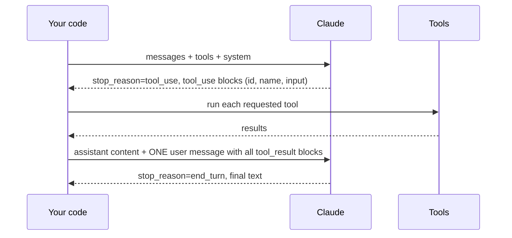

# 04. The agent loop and tool design

## The loop, step by step

Five rules that prevent most bugs (all visible in `ex02`):

1. **Append the full assistant content**, not only its text. The `tool_use`
   ids must come back, and thinking blocks must be replayed unchanged: recent
   models reject a history whose earlier turns were edited.
2. **Return every result of a turn in a single user message.** Claude may ask
   for several tools at once (parallel tool use). Splitting the results across
   messages teaches it to stop calling tools in parallel.
3. **Send errors back as `tool_result` with `is_error: true`.** The model can
   fix its input or change approach. Crashing the loop wastes the run.
4. **Always bound the loop**: turn limit, token or dollar budget, and detect
   identical repeated calls (`loop.py`).
5. **Check the stop reason** before reading the content.

| `stop_reason` | Meaning | What to do |
|---|---|---|
| `end_turn` | Finished | Read the text |
| `tool_use` | Wants tools | Run them, loop |
| `max_tokens` | Cut off | Raise `max_tokens` or stream; do not parse a truncated answer |
| `pause_turn` | A long server-tool turn paused | Send the content back as is to continue |
| `refusal` | Declined for safety reasons | Do not parse; read `stop_details`, show a fallback |
| `stop_sequence` | Hit a stop sequence you set | Expected |

## Tool design: the agent-computer interface

Tools are the API your agent programs against. Invest in them as much as in
the prompt.

**Names and descriptions are prompts.** Say what the tool does, when to use
it, what it returns, and its limits. Compare:

| Weak | Strong |
|---|---|
| `get(id)`: "Gets data" | `get_order(order_id)`: "Look up one order by its id (format ORD-1234). Returns status, items, dates, total and the customer's gift message. Use it before answering any question about a specific order." |

**Guidelines**

- **Few, meaningful tools.** One `search_catalog(query)` beats `list_books`,
  `filter_books`, `sort_books`. Fewer choices, fewer mistakes.
- **Tools that match tasks, not your database tables.** `check_refund_eligibility`
  encodes the policy; the model does not have to rebuild it from raw rows.
- **Strict schemas.** `required`, `enum`, `minimum`/`maximum`,
  `additionalProperties: false`. Set `strict: true` on the tool to guarantee the
  input validates.
- **Concise, useful results.** Return what the next decision needs, not a
  10 000-line dump. Paginate and truncate with a note ("showing 20 of 340").
- **Actionable errors.** "Unknown order ORD-9999. Ids look like ORD-1234."
  beats a stack trace.
- **Poka-yoke.** Make mistakes impossible: absolute paths instead of relative,
  ids instead of free text, amounts checked in code.
- **Mark side effects.** Read-only tools can run freely; irreversible ones
  need approval (`permission="ask"` in `loop.py`) and code-level limits.

## Kinds of tools

| Kind | Who executes | Examples | How to declare |
|---|---|---|---|
| **Client tools** | Your code | `get_order`, `issue_refund` | `name`, `description`, `input_schema` |
| **Anthropic-defined client tools** | Your code, schema known by the model | bash, text editor, computer use, memory | `{"type": "bash_20250124", "name": "bash"}` |
| **Server tools** | Anthropic | web search, web fetch, code execution, tool search | `{"type": "web_search_20260209", "name": "web_search"}` |
| **MCP tools** | An MCP server | Anything | Claude Code, Agent SDK, or the API MCP connector |

## Structured outputs instead of "tool tricks"

When you only need JSON back, do not create a fake tool: use
`output_config={"format": {"type": "json_schema", "schema": ...}}` (examples
01, 03, 05, 06, 07, 10). The answer is guaranteed to match the schema.

Note: the latest models no longer accept forcing a specific tool with
`tool_choice` (`{"type": "tool"}` or `{"type": "any"}`). Use `auto`, an
explicit instruction, `strict: true`, or structured outputs.

## Thinking and effort

Current models think adaptively before answering and between tool calls. You
control depth and cost with `output_config.effort` (`low` to `max`): low for
routing and simple workers, high or more for planning and hard coding tasks.
Measure on your eval set before raising it (chapter 12).

Next: [05. Workflow patterns](05-workflow-patterns.md).
