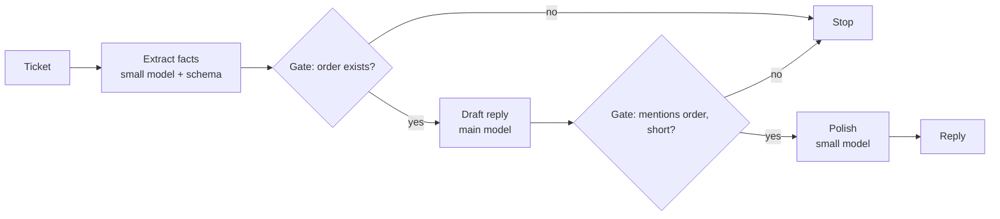
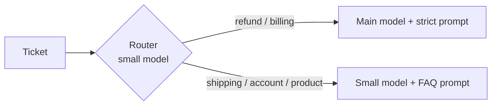
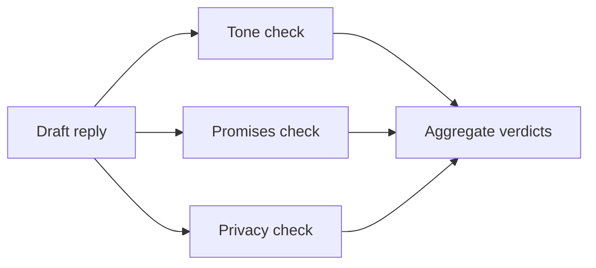
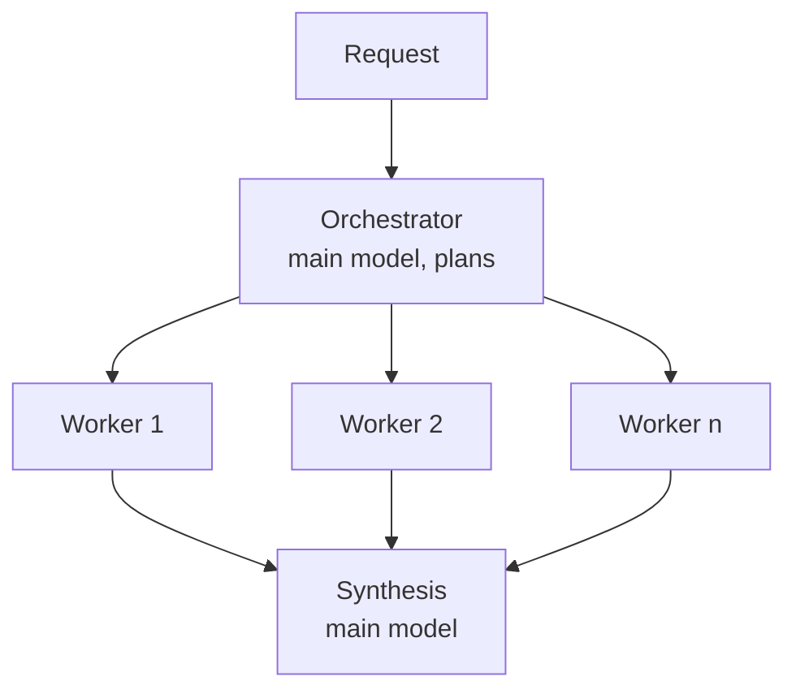
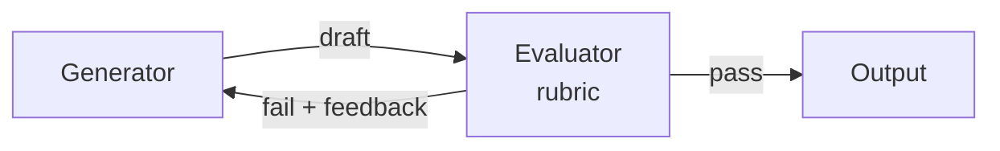

# 05. The five workflow patterns

Workflows are agentic systems where **your code** orchestrates model calls.
They are cheaper, faster and easier to test than agents. Most production
"agents" are actually one of these five patterns, or a mix.

| Pattern | Use when | Example |
|---|---|---|
| Prompt chaining | A task splits into fixed sequential steps | `ex03` |
| Routing | Inputs fall into distinct categories handled differently | `ex04` |
| Parallelization | Independent sub-tasks, or several opinions on one task | `ex05` |
| Orchestrator-workers | Sub-tasks depend on the input and cannot be listed in advance | `ex06` |
| Evaluator-optimizer | Clear quality criteria, and feedback improves the output | `ex07` |

## 1. Prompt chaining

Each call does one thing well, and **gates in code** catch errors between
steps. Trade latency for accuracy.

## 2. Routing

Separation of concerns: each route gets a specialised prompt, tools and
model. Also a cost lever: easy traffic goes to the small model. Evaluate the
router on its own (`ex10` does exactly that).

## 3. Parallelization

- **Sectioning**: independent sub-tasks in parallel, each with a focused
  prompt. Several narrow checks beat one call checking everything.
- **Voting**: the same task several times, then majority or threshold. More
  confidence on high-stakes yes/no questions.

## 4. Orchestrator-workers

The orchestrator decides the sub-tasks at run time (structured plan), workers
run in parallel with a **small, focused context** (only their data), and the
orchestrator merges. It is the bridge between workflows and multi-agent
systems (chapter 07).

## 5. Evaluator-optimizer

Works when you can write the criteria down and when a human's feedback would
help a human writer. Use a different model (or at least a fresh context) for
the evaluator, return structured verdicts, and cap the rounds.

## Combining patterns

Real systems compose them: a router in front, a chain on the refund route, a
parallel guardrail step before sending, an evaluator for marketing copy. Keep
each block testable on its own, with a fake client, as in `tests/`.

Next: [06. Context engineering](06-context-engineering.md).
