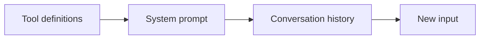

# 06. Context engineering: caching, compaction, memory

The context window is the agent's working memory. Everything in it costs
tokens, adds latency, and competes for attention. Context engineering is the
art of putting **the smallest set of high-signal tokens** in front of the
model at each step.

## What goes into the context

This order matters for caching: stable content first, volatile content last.

## The system prompt

- Write it like a brief for a smart new colleague: role, goal, rules, what
  good looks like, what to do when unsure.
- Be specific about behaviour, not shouting: "If the order is not found, ask
  for the id" beats "NEVER EVER guess".
- Use sections or XML tags for structure, and put examples of tricky cases.
- Recent models follow instructions closely: prompts written for older models
  are often too prescriptive. Remove rules that no longer earn their place.

## Prompt caching

The API can cache the prefix of a request (tools, system, early messages).
Cached tokens cost about a tenth of the normal input price and are faster.

- Add `cache_control={"type": "ephemeral"}` at the top level (automatic) or on
  specific blocks (up to 4 breakpoints). Default lifetime 5 minutes, 1 hour available.
- **Any byte change in the prefix invalidates the cache after it.** Never put
  timestamps, request ids or user-specific data before the breakpoint; keep
  the tool list deterministic.
- There is a minimum cacheable size (a few thousand tokens depending on the
  model): small prefixes are silently not cached.
- Verify with `usage.cache_read_input_tokens`. Zero across repeated calls
  means something invalidates the prefix.
- Mid-conversation instructions: recent models accept `{"role": "system"}`
  messages inside `messages`, which avoids editing the cached top-level system prompt.

`ex09` and the hardened loops place the cache breakpoint after the stable
system prompt and put the running summary after it.

## Compaction: keeping long sessions small

When the history grows, replace old turns with a summary that keeps what
matters (ids, amounts, decisions, open questions).

| Option | How | Notes |
|---|---|---|
| Client-side summary | Summarise old turns with a small model, keep the last N (`ex09`) | Portable, you control what is kept |
| Server-side compaction | `context_management={"edits": [{"type": "compact_20260112"}]}` with beta `compact-2026-01-12` | Append the full `response.content` so compaction blocks round-trip |
| Context editing | `clear_tool_uses_20250919` clears old tool results | Big tool outputs are often the main cost |
| Claude Code | `/compact` and automatic compaction | Plus `CLAUDE.md` for what must survive |

## Memory: what survives between sessions

Do not grow the prompt forever. Store durable facts outside and let the
agent read and write them through tools.

| Mechanism | Where | Example |
|---|---|---|
| Notes store behind tools | Your database or files | `ex09` `MemoryNotes` |
| Memory tool | API tool `memory_20250818`, you implement the storage | Agent organises its own files |
| `CLAUDE.md` | Claude Code project, user and enterprise levels | Conventions, commands, decisions |
| Memory stores | Managed Agents | Persistent, versioned, shared across sessions |

Write memories as facts with their reason, update rather than duplicate,
delete what turns out wrong, and never store secrets.

## Just-in-time context

Instead of loading everything up front, give the agent tools to fetch what
it needs (search, read a file, query a table). Claude Code works this way:
it greps and reads files on demand rather than receiving the whole repo.
Subagents (chapter 07) are another tool: they explore in their own context
and return only a summary.

Next: [07. Multi-agent systems](07-multi-agent.md).
