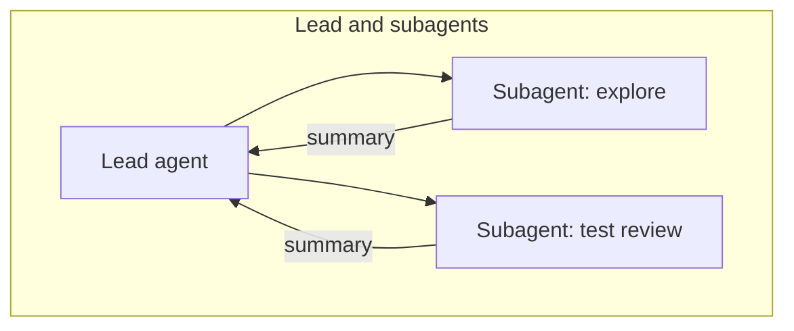

# 07. Multi-agent systems

## When several agents beat one

A single agent with good tools is the default. Move to several agents when:

- the work **splits into independent parts** that can run in parallel
  (research across many sources, review of many files);
- **one context window is not enough**, or exploration noise would drown the
  main task;
- parts need **different permissions or prompts** (a read-only explorer, a
  writer with edit rights, a reviewer).

Costs: multi-agent systems use several times more tokens, are harder to debug
and to evaluate. Tasks that need tight shared context (most coding edits) are
often better with one agent.

## Architectures

| Architecture | Description | In this repo |
|---|---|---|
| **Orchestrator-workers (workflow)** | Code fans out to workers and merges | `ex06` |
| **Lead agent + subagents** | The lead decides at run time to delegate, through an Agent tool | `ex12`, `claude-code/.claude/agents` |
| **Pipeline of agents** | Agent A's output is agent B's input (spec, then code, then review) | Combine `ex03` with agents |
| **Generator + critic** | One produces, one judges | `ex07` |
| **Peer agents over a protocol** | Independent services that call each other (MCP, HTTP) | `ex11` as the shared tool layer |

## Delegating well

The lead must write a **brief**, not a one-liner. A good delegation states:

1. the objective and why it matters;
2. the expected output format (and its maximum length);
3. what tools and sources to use, and what to avoid;
4. the boundaries: what is out of scope, when to stop.

The subagent returns a compact result. The lead's context only grows by that
summary, not by everything the subagent read.

## Subagents in practice

- **Claude Code**: Markdown files in `.claude/agents/` (name, description,
  tools, model). Claude delegates when the description matches, or you ask
  explicitly ("use the code-reviewer subagent").
- **Agent SDK**: `agents={"test-reviewer": AgentDefinition(...)}` and allow the
  `Agent` tool (`ex12`).
- **Managed Agents**: a `multiagent` configuration with a roster of subagents,
  or dynamic workflows where the agent runs many agents in phases.

## Model mix

Use the most capable model where judgment matters (lead, planner, final
synthesis) and a small model for high-volume narrow work (workers, readers,
classifiers). Measure first: a single capable model at lower effort is often
as good and simpler.

Next: [08. MCP](08-mcp.md).
