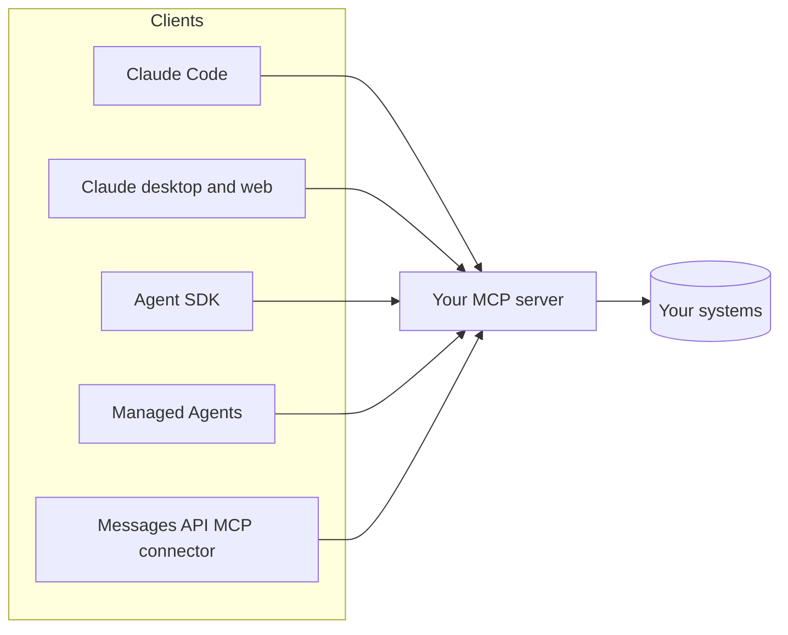

# 08. MCP: the Model Context Protocol

MCP is an open protocol that lets any agent use tools, read resources and
reuse prompts exposed by a server. Write the integration once, use it from
every MCP client.



## The three primitives

| Primitive | Controlled by | Example in `ex11` |
|---|---|---|
| **Tools** | The model decides to call them | `get_order`, `search_catalog`, `check_refund_eligibility` |
| **Resources** | The application or user attaches them | `paperleaf://policy` |
| **Prompts** | The user picks them (often as slash commands) | (add your own templates) |

## Transports

- **stdio**: the client starts the server as a local process. Simple and
  private; what `ex11` uses.
- **Streamable HTTP**: a remote server, shared by many users, usually with
  OAuth. Needed for claude.ai connectors, Managed Agents and the API connector.

## Using the example server

```bash
# Claude Code
claude mcp add paperleaf -- uv run --directory python python examples/ex11_mcp_server.py
# or the TypeScript version
claude mcp add paperleaf-ts -- npx tsx typescript/src/examples/11-mcp-server.ts
# or the Kotlin version (-q keeps stdout clean)
claude mcp add paperleaf-kt -- ./gradlew -q -p kotlin run -Pexample=Ex11McpServer
# then, in Claude Code: "Is ORD-1003 refundable?"
```

From the Agent SDK, pass it in `mcp_servers` (`ex12`). From the Messages API,
a remote server is declared with `mcp_servers=[{"type": "url", ...}]` **and**
`tools=[{"type": "mcp_toolset", "mcp_server_name": ...}]` with the
`mcp-client-2025-11-20` beta.

## Designing a good server

- Same rules as any tool (chapter 04): few task-shaped tools, strong
  descriptions, concise results, actionable errors.
- **Least privilege**: `ex11` exposes no refund tool on purpose. Separate
  read-only and write servers, or scope writes per user.
- Annotate tools (`readOnlyHint`, `destructiveHint`) so clients can decide
  what needs confirmation.
- **Treat what comes back as untrusted.** A server that returns third-party
  text (emails, web pages, tickets) is a prompt-injection channel. Only
  install servers you trust, and pin their versions.
- Test it without a model: Python and TypeScript have in-memory clients
  (`tests/test_evals_mcp_sdk.py`, `tests/evals-mcp-sdk.test.ts`); the Kotlin
  test wires a real client to the server through pipes (`McpServerTest.kt`).

Next: [09. Claude Code as an agent platform](09-claude-code.md).
