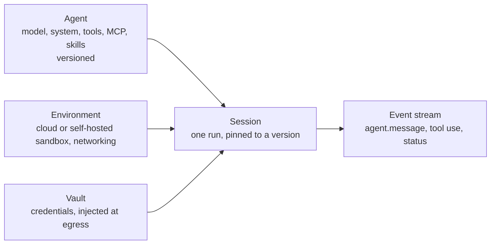

# 10. Claude Agent SDK and Claude Managed Agents

Both give you a production-grade agent without writing the loop. The
difference is **who hosts the tools**.

| | Agent SDK | Managed Agents |
|---|---|---|
| What it is | The Claude Code harness as a library | A hosted agent service (beta) |
| Languages | Python, TypeScript | Any (REST), SDKs in all languages, `ant` CLI |
| Loop runs | In your process | On Anthropic's side |
| Tools run | On your machine or container | In a per-session sandbox hosted by Anthropic (or self-hosted) |
| State | Sessions you can resume, files on your disk | Persisted, versioned agents; sessions with event streams; memory stores |
| Best for | CI bots, internal tools, coding agents on your infra | Long-running, scheduled or many concurrent agents without operating sandboxes |
| Example | `ex12` (Python and TypeScript) | `ex14` (Python) |

## Agent SDK essentials

```python
options = ClaudeAgentOptions(
    cwd="/repo",
    system_prompt="You audit codebases. You never modify files.",
    allowed_tools=["Read", "Grep", "Glob", "Agent"],   # what may run without asking
    disallowed_tools=["Write", "Edit", "Bash"],        # never available
    max_turns=30, max_budget_usd=1.0,                   # hard limits
    hooks={"PreToolUse": [HookMatcher(matcher="Read", hooks=[block_secrets])]},
    agents={"test-reviewer": AgentDefinition(description=..., prompt=..., tools=[...], model="haiku")},
    mcp_servers={"paperleaf": {"command": "uv", "args": [...]}},
)
async for message in query(prompt="...", options=options):
    ...
```

| Feature | How |
|---|---|
| One-shot task | `query(prompt, options)` |
| Multi-turn, interactive | `ClaudeSDKClient` (send, receive, interrupt) |
| Resume a session | `resume=<session_id>` or `continue_conversation=True` |
| Custom tools | `@tool` + `create_sdk_mcp_server` (in process), or any MCP server |
| Permission callback | `can_use_tool=async (name, input, ctx) -> allow / deny` |
| Load project files | `setting_sources=["project"]` to use `CLAUDE.md`, skills, subagents of the repo |
| Structured result | `output_format` with a JSON schema |
| Sandboxing | `sandbox` settings for the bash tool |

It needs the Claude Code CLI installed on the host.

## Managed Agents essentials

Four objects:



1. **Create the agent once** (setup script or `ant apply` from version-controlled
   files), store its id and version. Update it with a new version, never
   recreate it on each run.
2. **Create a session per run**, referencing the agent and an environment.
3. **Open the event stream first**, then send `user.message` (or
   `user.define_outcome` for a single deliverable graded against a rubric).
4. Read events until `session.status_idle` (unless it is waiting for you with
   `requires_action`, for example a tool confirmation or a custom tool result).

Also available: permission policies per tool (`always_allow`, `always_ask`,
`auto`), custom tools executed by your code, MCP servers with credentials in
vaults, memory stores, multi-agent rosters and workflows, scheduled
deployments (cron), session budgets in dollars, and a session viewer in the
Console to inspect every event.

`ex14_managed_agents.py` shows the setup and run phases, and its test checks
the two rules people break most: the version is pinned, and the stream is
opened before the message is sent.

Next: [11. Guardrails and security](11-guardrails-and-security.md).
