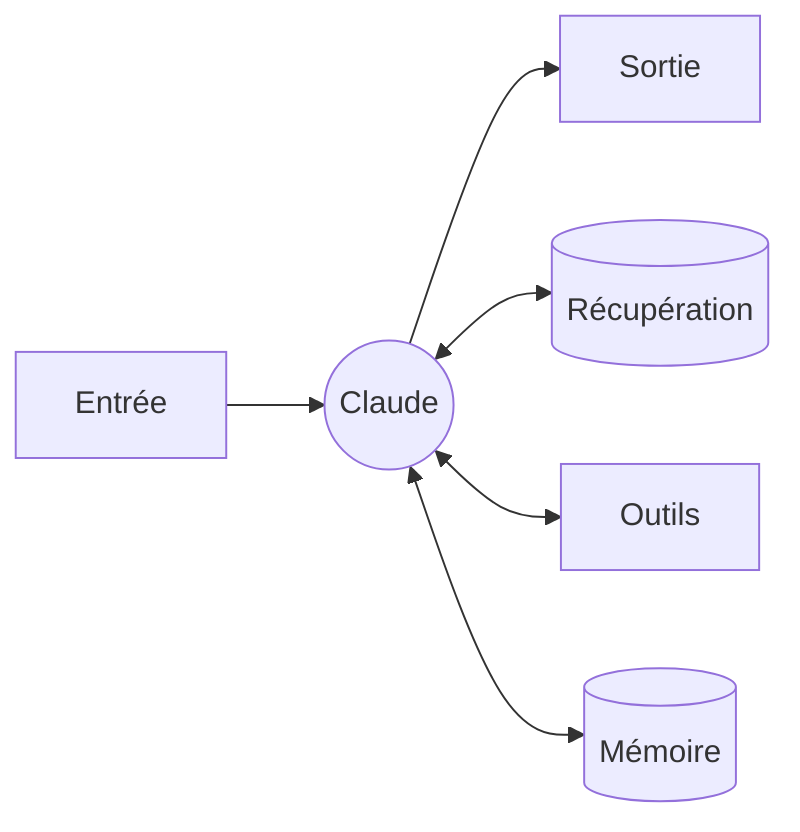
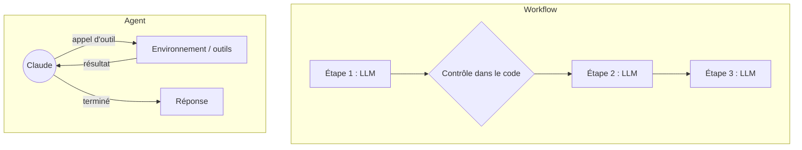
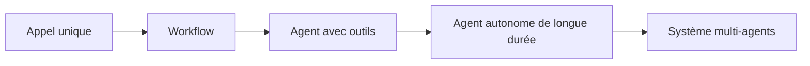

# 01. Fondamentaux : d'un appel unique à un agent

## Le LLM augmenté

La brique de base de tout système agentique est un appel au modèle
**augmenté** de trois choses :

- **la récupération** (retrieval) : les données dont il a besoin, placées dans son contexte ;
- **les outils** : des fonctions qu'il peut demander à votre code d'exécuter ;
- **la mémoire** : ce dont il doit se souvenir d'un tour ou d'une session à l'autre.

L'exemple 01 en est la version utile la plus petite : un appel, un prompt
système précis, et un schéma JSON (`output_config.format`) qui garantit une
réponse analysable.

## Workflow ou agent ?

Les deux sont des « systèmes agentiques ». La différence : **qui décide de
l'étape suivante**.

| | Workflow | Agent |
|---|---|---|
| Flot de contrôle | Votre code, fixé à l'avance | Le modèle, à l'exécution |
| Nombre d'étapes | Connu | Inconnu, borné par des limites |
| Prévisibilité | Élevée | Plus faible |
| Coût et latence | Prévisibles | Variables, souvent plus élevés |
| Idéal pour | Tâches bien définies et répétables | Tâches ouvertes, difficiles à scripter |
| Exemples ici | 03 à 07 | 02, 08, 09, 12 |

## Faut-il vraiment construire un agent ?

Vérifiez quatre critères. Si l'un des quatre répond « non », restez à un niveau plus simple.

1. **Complexité** : la tâche est-elle multi-étapes et difficile à spécifier à
   l'avance ? « Transformer ce rapport de bug en correctif », oui ; « extraire
   le total d'une facture », non.
2. **Valeur** : le résultat justifie-t-il plus de tokens et plus de latence ?
3. **Faisabilité** : Claude sait-il bien faire ce type de tâche ? Essayez à la main.
4. **Coût de l'erreur** : les erreurs peuvent-elles être détectées et annulées
   (tests, revue, validation, retour arrière) ? Si une erreur est irréversible
   et invisible, ajoutez un humain.

## L'échelle d'autonomie

Chaque cran vers la droite apporte de la souplesse et se paie en coût, en
latence et en difficulté à tester. Montez d'un cran à la fois, et seulement
quand une évaluation montre que le niveau actuel ne suffit pas.

## De quoi est fait un agent

Quel que soit le framework, un agent a les mêmes composants :

| Composant | Question à laquelle il répond | Dans ce dépôt |
|---|---|---|
| Modèle | Qui réfléchit ? | `MODEL`, `FAST_MODEL` dans `config` |
| Instructions | Quelle est la mission, quelles sont les règles ? | les prompts `SYSTEM` |
| Outils | Que peut-il faire dans le monde ? | définitions d'outils de `bookshop` |
| Boucle | Comment itère-t-il ? | `ex02`, `loop.py`, `loop.ts`, `Agent.kt` |
| Stratégie de contexte | Que voit-il à chaque étape ? | `ex09` |
| Mémoire | Qu'est-ce qui persiste entre les sessions ? | `ex09` `MemoryNotes` |
| Garde-fous | Que ne peut-il jamais faire ? | `ex08`, hooks Claude Code |
| Règles d'arrêt | Quand s'arrête-t-il ? | limite de tours, budget, réponse finale |
| Évaluations | Comment sait-on qu'il fonctionne ? | `ex10` |

Suite : [02. Les types d'agents](02-agent-types.md).
