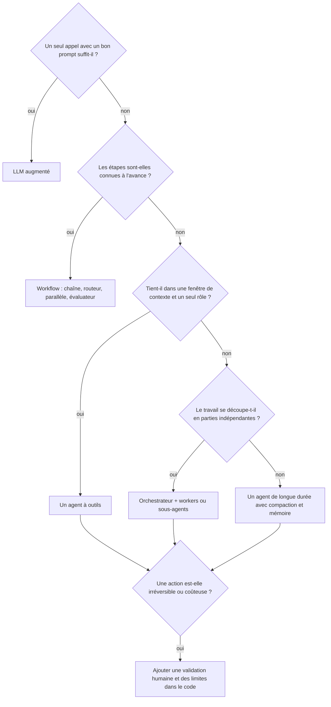

# 02. Les types d'agents : la carte complète

« Agent » recouvre des choses très différentes. Ce chapitre les classe selon
six axes indépendants. Un agent réel est une combinaison : par exemple un agent
de *code* (domaine) lancé en mode *headless* (interaction) comme *sous-agent*
(rôle) sur une infrastructure *auto-hébergée* (hébergement), avec une *mémoire
de session* (état) et une autonomie *supervisée*.

## Axe 1. Le niveau d'autonomie

| Type | Qui décide des étapes | Arrêt typique | Exemple dans ce dépôt |
|---|---|---|---|
| **LLM augmenté** | Personne : un seul appel | Une réponse | `ex01` tri des tickets |
| **Workflow** (chaîne de prompts, routeur, pipeline) | Votre code | Fin du script | `ex03` à `ex07` |
| **Agent à outils** | Le modèle, dans une boucle bornée | Réponse sans appel d'outil, ou limite de tours | `ex02`, `ex08` |
| **Agent autonome de longue durée** | Le modèle, pendant des minutes ou des heures, avec son propre plan, ses fichiers et ses points d'étape | Objectif atteint, budget épuisé, ou interruption humaine | `ex12` (Agent SDK), Claude Code, Managed Agents |

Règle simple : plus il y a d'autonomie, plus il faut de garde-fous
(chapitre 11) et d'évaluations (chapitre 12).

## Axe 2. Le mode d'interaction

| Type | Description | Quand l'utiliser | Comment il démarre |
|---|---|---|---|
| **Assistant conversationnel** | Un humain envoie chaque message, l'agent répond, en utilisant éventuellement des outils entre-temps | Chat de support, copilotes, helpdesk interne | Une interface de chat, Slack, `claude` dans un terminal |
| **Agent de tâche** | Reçoit un objectif, travaille jusqu'à l'atteindre, puis rend compte | « Corrige ce bug », « rédige les notes de version » | `claude -p "..."`, `query(prompt)` dans le SDK, un appel API |
| **Agent d'arrière-plan (ambiant)** | Se réveille sur un événement, sans qu'un humain le sollicite | Trier chaque nouveau ticket, relire chaque PR, rapports nocturnes | Webhook, pipeline CI, cron, routine planifiée |
| **Agent batch** | Exécute la même tâche sur beaucoup d'entrées, résultats récupérés plus tard | Classer 10 000 tickets, enrichir un catalogue | API Message Batches (moitié prix, asynchrone) |
| **Agent avec humain dans la boucle** | Travaille seul mais s'arrête pour validation sur les actions risquées | Remboursements, déploiements, emails envoyés aux clients | N'importe lequel des modes ci-dessus, plus une étape de validation (`ex08`) |

## Axe 3. Le rôle dans un système

Quand plusieurs appels au modèle coopèrent, chacun joue un rôle.

| Rôle | Mission | Choix du modèle | Exemple |
|---|---|---|---|
| **Routeur / classifieur** | Décide où envoyer une entrée | Petit modèle rapide | `ex04` |
| **Planificateur / orchestrateur / chef** | Découpe un objectif en sous-tâches, délègue, fait la synthèse | Le modèle le plus capable | `ex06` |
| **Worker (exécutant)** | Exécute une sous-tâche précise avec un contexte ciblé | Petit ou moyen modèle | workers de `ex06` |
| **Sous-agent** | Un agent complet (prompt, outils, fenêtre de contexte propres) appelé par un agent parent comme un outil | Selon la tâche | `test-reviewer` de `ex12`, `claude-code/.claude/agents` |
| **Évaluateur / critique** | Note la sortie d'un autre modèle selon une grille et donne un retour | Un modèle différent du rédacteur | `ex07` |
| **Juge** | Note des sorties hors ligne pour les évaluations | Modèle capable, grille explicite | `judge_reply` de `ex10` |
| **Garde** | Vérifie entrées ou sorties au regard d'une politique | Petit modèle, ou du code | vérifications de `ex05` |
| **Résumeur / compacteur** | Compresse l'historique pour garder un contexte léger | Petit modèle | `ex09` |

## Axe 4. Le domaine et les capacités

| Type | Ce qu'il fait | Outils clés | Risques principaux |
|---|---|---|---|
| **Agent de code** | Lit, modifie, exécute et teste du code | Lecture et édition de fichiers, shell, tests, git | Commandes destructrices, secrets, modifications erronées |
| **Agent de recherche** | Cherche, lit et synthétise des sources | Recherche web, lecture de pages, citations | Injection depuis des pages, sources inventées |
| **Agent de données / d'analyse** | Exécute du code sur des données, produit graphiques et rapports | Bac à sable d'exécution de code, fichiers | Chiffres faux présentés avec assurance |
| **Agent d'usage d'ordinateur / navigateur** | Pilote une interface graphique par captures, clics et frappe | Outil computer use, automatisation de navigateur | Agir sur le mauvais écran, contenu de page injecté |
| **Agent au contact des clients** | Répond aux clients, agit sur leur compte | API métier (commandes, remboursements) | Fraude, non-respect de la politique, ton |
| **Agent d'exploitation (SRE, IT)** | Enquête sur les incidents, déroule des runbooks | Logs, métriques, CLI cloud | Modifications en production |
| **Assistant personnel** | Emails, agenda, documents, tâches | Un serveur MCP par service | Envoi en votre nom, vie privée |

## Axe 5. Où il tourne (hébergement)

| Type | Qui exécute la boucle | Qui exécute les outils | Produit |
|---|---|---|---|
| **Agent local** | Un processus sur votre machine | Votre machine | CLI Claude Code, extensions IDE, application desktop |
| **Service auto-hébergé** | Votre serveur | Votre serveur | API Messages + votre boucle, Tool Runner, Agent SDK |
| **Agent géré** | Anthropic | Un bac à sable hébergé par Anthropic pour chaque session (plus vos propres outils si besoin) | Claude Managed Agents |
| **Agent embarqué** | Une plateforme | La plateforme | Claude dans Slack, GitHub Action, claude.ai |

## Axe 6. L'état et la mémoire

| Type | Se souvient de | Comment |
|---|---|---|
| **Sans état** | Rien entre deux appels | Chaque requête transporte tout (`ex01`) |
| **État de session** | La conversation en cours | Historique renvoyé à chaque tour, compaction quand il grossit (`SupportSession` de `ex09`) |
| **Mémoire longue** | Des faits d'une session à l'autre | Un stockage que l'agent lit et écrit via des outils (`MemoryNotes` de `ex09`), l'outil mémoire de l'API, les fichiers `CLAUDE.md` de Claude Code, les memory stores de Managed Agents |
| **État d'espace de travail** | Les fichiers qu'il a produits | Un répertoire de travail ou un bac à sable (Agent SDK, Managed Agents) |

## Choisir un type : l'arbre de décision

Suite : [03. Toutes les façons de créer, lancer et utiliser un agent](03-build-and-run.md).
