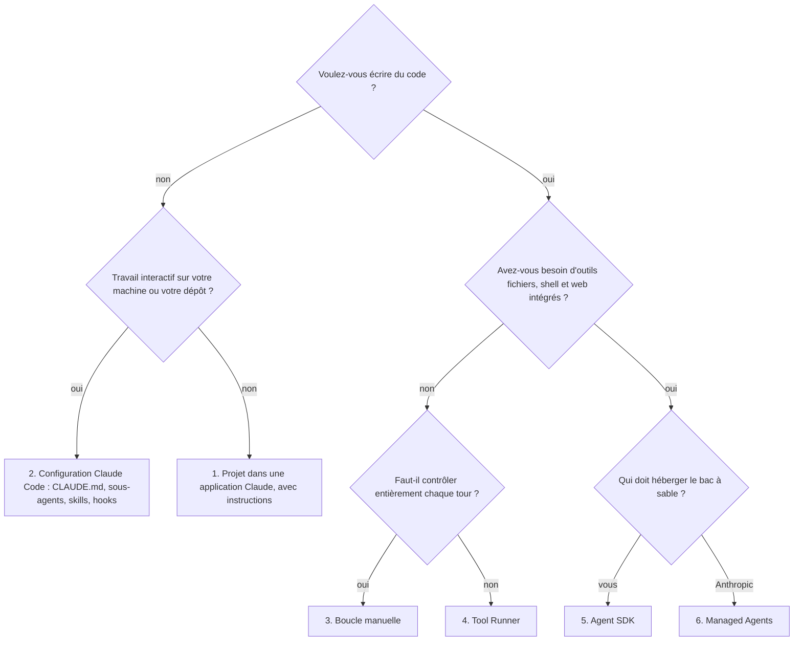

# 03. Toutes les façons de créer, lancer et utiliser un agent Claude

Le chapitre 02 disait *quels types* d'agents existent. Celui-ci dit
*comment* : les huit façons d'en construire un, les façons de le démarrer, et
les façons de le mettre à disposition d'utilisateurs ou de systèmes. Pour
chacune : ce que c'est, quand la choisir, un extrait minimal, et où la trouver
dans ce dépôt.

## Partie 1. Huit façons de créer un agent

Deux questions séparent les options : **qui écrit la boucle** (requête,
exécution des outils, on recommence) et **qui l'héberge**.

| # | Approche | Vous écrivez | Boucle fournie par | Hébergé par | Outils intégrés |
|---|---|---|---|---|---|
| 1 | Agent par prompt dans les applications Claude (Projets, instructions) | Des instructions et des fichiers | claude.ai | Anthropic | Ceux des applications (recherche, fichiers, connecteurs) |
| 2 | Configuration de Claude Code (sans code) | Des fichiers Markdown et JSON | Claude Code | Votre machine ou la CI | Read, Edit, Bash, Grep, web, MCP... |
| 3 | API Messages, boucle manuelle | Tout | Vous | Vous | Uniquement les vôtres, plus les outils serveur |
| 4 | API Messages, Tool Runner | Les fonctions des outils | Le SDK (`tool_runner`) | Vous | Uniquement les vôtres, plus les outils serveur |
| 5 | Claude Agent SDK | Un prompt et des options | Le harnais de Claude Code, en bibliothèque | Vous | Les outils de Claude Code, MCP, sous-agents |
| 6 | Claude Managed Agents | Une configuration d'agent | Anthropic | Anthropic (un bac à sable par session) | Bash, fichiers, code, web, MCP, skills |
| 7 | Serveur MCP (étend toutes les options ci-dessus) | Outils, ressources, prompts | L'agent client | Vous | sans objet |
| 8 | Frameworks tiers | Du code de framework | Le framework | Vous | Ceux du framework |

Comment choisir :



Quel que soit votre choix, exposez vos capacités métier sous forme de
**serveur MCP** (option 7) : tous les agents pourront les réutiliser.

### 1. Agent par prompt dans une application Claude

Un Projet sur claude.ai, avec des instructions, des fichiers de connaissance
et des connecteurs (Gmail, Drive, vos serveurs MCP), est déjà un agent :
Claude décide quand chercher, lire ou appeler un connecteur. Pas de code, pas
d'hébergement.

- **À choisir pour** : assistants personnels ou d'équipe, prototypes de prompt.
- **Limites** : pas de contrôle de la boucle, pas de tests automatisés, un humain dans le chat.

### 2. Configuration de Claude Code (sans code)

Claude Code est un agent généraliste que l'on spécialise avec des fichiers
dans le dépôt. Voir le [chapitre 09](09-claude-code.md) et le dossier
[`claude-code/`](../../claude-code).

| Fichier | Crée |
|---|---|
| `CLAUDE.md` | La mémoire du projet, chargée à chaque session |
| `.claude/agents/<nom>.md` | Un **sous-agent** : son prompt, ses outils, son modèle, sa fenêtre de contexte |
| `.claude/skills/<nom>/SKILL.md` | Une **skill** : instructions et scripts chargés à la demande |
| `.claude/settings.json` | Permissions et **hooks** (code exécuté avant ou après les appels d'outils) |
| `.mcp.json` | Les serveurs MCP disponibles pour le projet |
| Un plugin | Tout ce qui précède, empaqueté et partageable |

Un sous-agent en dix lignes :

```markdown
---
name: code-reviewer
description: Relit un diff à la recherche de bugs et de tests manquants. À utiliser de façon proactive avant de committer.
tools: Read, Grep, Glob, Bash
model: sonnet
---
Tu es un relecteur senior. Lance `git diff`, rends tes remarques au format fichier:ligne | gravité | correctif.
```

- **À choisir pour** : le code, l'automatisation de dépôt, les runbooks d'exploitation, tout ce qui vit à côté de fichiers.

### 3. API Messages, boucle manuelle

Vous appelez `POST /v1/messages` avec des `tools`, exécutez ce que Claude
demande, renvoyez des blocs `tool_result`, et recommencez tant que
`stop_reason` vaut `tool_use`. Code complet : `ex02` dans chaque langage.

```python
while True:
    response = client.messages.create(model=MODEL, max_tokens=16000,
                                      system=SYSTEM, tools=TOOLS, messages=messages)
    messages.append({"role": "assistant", "content": response.content})
    if response.stop_reason != "tool_use":
        break
    messages.append({"role": "user", "content": [run(b) for b in response.content if b.type == "tool_use"]})
```

- **À choisir pour** : un contrôle total (validation sur mesure, journalisation,
  routage à chaque tour), aucune dépendance à une beta, n'importe quel langage
  doté d'un SDK (Python, TypeScript, Java et Kotlin, Go, Ruby, C#, PHP).
- **Version durcie** : `loop.py`, `loop.ts`, `Agent.kt` (permissions,
  validation, données non fiables, limites).

### 4. API Messages, Tool Runner

Le SDK fait tourner la boucle ; vous n'écrivez que des fonctions d'outils typées.
Code complet : `ex13`.

```python
from anthropic import beta_tool

@beta_tool
def get_order(order_id: str) -> str:
    """Retrouve une commande par son identifiant (format ORD-1234)."""
    return json.dumps(shop.get_order(order_id))

runner = client.beta.messages.tool_runner(
    model="claude-opus-5-5", max_tokens=16000, tools=[get_order],
    messages=[{"role": "user", "content": "Où en est ORD-1003 ?"}],
)
for message in runner:   # une itération par tour du modèle
    print(message.content)
```

En TypeScript : `betaZodTool` et `client.beta.messages.toolRunner` ; en Java et
Kotlin : des classes annotées. Le runner expose toujours chaque tour, ce qui
permet d'ajouter validation ou journalisation.

- **À choisir pour** : la plupart des agents à outils sur mesure, quand vous n'avez pas besoin de maîtriser chaque ligne de la boucle.

### 5. Claude Agent SDK

Claude Code empaqueté en bibliothèque (`claude-agent-sdk` en Python,
`@anthropic-ai/claude-agent-sdk` en TypeScript). Vous récupérez les outils
intégrés, la gestion du contexte, les sous-agents, les hooks, les permissions,
les sessions et MCP. Code complet : `ex12`.

```python
async for message in query(prompt="Audite ce dépôt", options=ClaudeAgentOptions(
        cwd=repo, allowed_tools=["Read", "Grep", "Glob"], max_budget_usd=1.0)):
    if isinstance(message, ResultMessage):
        print(message.result)
```

- `query()` pour une tâche ; `ClaudeSDKClient` pour une session multi-tours avec état.
- Outils sur mesure : serveur MCP en mémoire (`@tool` + `create_sdk_mcp_server`) ou n'importe quel serveur MCP externe.
- **À choisir pour** : agents de code ou très orientés fichiers sur votre propre infrastructure, bots de CI, outils internes.
- **Pas de version JVM** : depuis Kotlin, appelez la CLI en mode headless (`claude -p`) ou utilisez l'API Messages.

### 6. Claude Managed Agents

Anthropic fait tourner la boucle **et** un conteneur isolé par session. Vous
définissez l'agent une fois (versionné), puis vous démarrez des sessions et
lisez leur flux d'événements. Code complet : `ex14`.

```python
agent = client.beta.agents.create(            # une seule fois, dans un script d'installation
    name="Analyste support", model="claude-opus-5-5",
    system="Tu analyses des exports du support et rédiges des rapports.",
    tools=[{"type": "agent_toolset_20260401",
            "default_config": {"permission_policy": {"type": "auto"}}}],
)
environment = client.beta.environments.create(
    name="analyse", config={"type": "cloud", "networking": {"type": "limited"}})

session = client.beta.sessions.create(        # à chaque exécution
    agent={"type": "agent", "id": agent.id, "version": agent.version},
    environment_id=environment.id)
with client.beta.sessions.events.stream(session_id=session.id) as stream:
    client.beta.sessions.events.send(session_id=session.id, events=[
        {"type": "user.message", "content": [{"type": "text", "text": "Résume les tickets de la semaine"}]}])
    for event in stream:
        if event.type == "agent.message":
            print("".join(b.text for b in event.content if b.type == "text"))
        elif event.type == "session.status_idle" and event.stop_reason.type != "requires_action":
            break
```

En plus : des coffres (vaults) pour les identifiants, des memory stores, des
outcomes (un correcteur fait itérer l'agent jusqu'à ce qu'une grille soit
respectée), des workflows multi-agents, des déploiements planifiés, des
budgets en dollars par session. Les configurations d'agents peuvent vivre dans
des fichiers synchronisés avec la CLI `ant` (`ant apply`). Voir le
[chapitre 10](10-agent-sdk-and-managed-agents.md).

- **À choisir pour** : agents de longue durée ou planifiés, quand vous ne voulez pas exploiter vous-même des bacs à sable.

### 7. Serveurs MCP

Ce n'est pas un agent en soi, mais un moyen de donner de nouvelles capacités
à **n'importe quel** agent via un protocole standard. Écrit une fois,
utilisable depuis Claude Code, l'application desktop, l'Agent SDK, Managed
Agents ou le connecteur MCP de l'API. Code : `ex11`. Voir le
[chapitre 08](08-mcp.md).

### 8. Frameworks tiers

Les frameworks d'orchestration enveloppent la même API Messages. Ils peuvent
accélérer un prototype, mais ajoutent une couche d'abstraction entre vous et
le modèle. Apprenez d'abord les options 3 à 5 : vous comprendrez alors ce que
fait n'importe quel framework, et saurez le déboguer.

## Partie 2. Les façons de lancer un agent

| Mode de lancement | Comment | Usage typique | Dans ce dépôt |
|---|---|---|---|
| **Terminal interactif** | `claude` dans un dépôt | Programmation en binôme, exploration | `claude-code/` |
| **IDE / desktop / web** | Extensions VS Code et JetBrains, application desktop, claude.ai/code | Idem avec une interface, sessions distantes | |
| **Headless en une fois** | `claude -p "tâche" --output-format json` | Scripts, hooks git, étapes de CI | `claude-code/headless/review-diff.sh` |
| **Session en arrière-plan** | `claude --bg "tâche"`, puis `claude agents`, `claude attach <id>`, `claude logs <id>` | Plusieurs tâches en parallèle sur une même machine | |
| **Worktree isolé** | `claude -w feature-x` crée un worktree git pour la session | Agents en parallèle sur le même dépôt sans conflit | |
| **Session cloud** | `claude --cloud "tâche"`, ou claude.ai/code | S'exécute à distance, continue quand votre portable est en veille | |
| **Session reprise** | `claude --continue` ou `--resume <id>`, option `resume` du SDK | Longues tâches en plusieurs fois | |
| **Depuis votre code** | Boucle `client.messages.create`, `tool_runner`, `query()` | Produits et services | `ex02`, `ex12`, `ex13` |
| **En sous-agent** | Un agent parent délègue via son outil Agent | Isoler le contexte, recherches parallèles | `.claude/agents/`, `ex12` |
| **En CI** | GitHub Action `anthropics/claude-code-action`, ou `claude -p` dans n'importe quel pipeline | Revue de PR, mentions `@claude`, corrections automatiques | `claude-code/github-actions/` |
| **Selon un planning** | Cron + commande headless, routines Claude Code (`/schedule`), déploiements planifiés de Managed Agents | Rapports nocturnes, audits hebdomadaires | |
| **Sur un événement** | Un webhook (ticket, email, alerte) appelle votre service, qui démarre l'agent | Agents ambiants | |
| **En masse** | API Message Batches : beaucoup de requêtes, résultats sous 24 h, moitié prix | Classification hors ligne, enrichissement | |
| **Dans une messagerie** | Claude dans Slack, votre propre bot | Assistants d'équipe | |

À vérifier quel que soit le mode de lancement :

- une **limite de tours** et un **budget** (`max_turns`, `max_budget_usd`, budgets de session) ;
- des **outils au moindre privilège** (lecture seule par défaut) ;
- des **logs** de chaque appel d'outil ;
- un **délai maximal** et un comportement clair en cas d'échec (nouvel essai, alerte, abandon).

## Partie 3. Les façons d'utiliser un agent (patterns d'intégration)

| Pattern | Description | Interface | Remarques |
|---|---|---|---|
| **Assistant de chat** | Humain et agent parlent à tour de rôle | Interface en streaming, Slack | Streamer les tokens, montrer l'activité des outils |
| **Copilote dans une application** | L'agent agit sur les données de l'utilisateur dans votre produit | Votre API | Permissions des outils par utilisateur |
| **Exécuteur de tâches** | On donne un objectif, on reçoit un résultat ou une pull request | CLI, endpoint d'API, file de messages | Rendre le résultat relisible (diff, rapport) |
| **Bot de PR ou de tickets** | Réagit aux événements d'une plateforme | Webhooks GitHub, Jira, helpdesk | Commenter, ne jamais merger seul |
| **Étape de pipeline** | Une étape d'un pipeline de données ou de documents | Batch, file de messages | En général un workflow, pas un agent |
| **Fournisseur d'outils** | Votre système exposé aux agents des autres | Serveur MCP | Lecture seule d'abord, puis écritures restreintes |
| **Agent comme outil** | Un agent en appelle un autre (sous-agent, A2A sur HTTP) | Outil Agent, MCP, HTTP | Transmettre un brief compact, recevoir un résultat compact |

## Une même tâche, de toutes les façons : « Où en est la commande ORD-1003 ? »

| Façon | Ce que vous faites |
|---|---|
| Application Claude | Ajoutez le serveur MCP Paperleaf comme connecteur, posez la question dans le chat |
| Claude Code | `claude mcp add paperleaf -- uv run --directory python python examples/ex11_mcp_server.py`, puis posez la question |
| Boucle manuelle | `uv run python examples/ex02_agent_loop.py "Where is ORD-1003?"` |
| TypeScript | `npx tsx src/examples/02-agent-loop.ts "Where is ORD-1003?"` |
| Kotlin | `./gradlew run -Pexample=Ex02AgentLoop --args="Where is ORD-1003?"` |
| Tool Runner | `uv run python examples/ex13_tool_runner.py "Where is ORD-1003?"` |
| CLI headless | `claude -p "Where is ORD-1003?" --mcp-config claude-code/.mcp.json` |
| Agent SDK | `query(prompt="Where is ORD-1003?", options=ClaudeAgentOptions(mcp_servers=...))` |
| Managed Agents | Créez l'agent avec le serveur MCP, démarrez une session, envoyez le message |

Suite : [04. La boucle d'agent et la conception des outils](04-agent-loop-and-tools.md).
