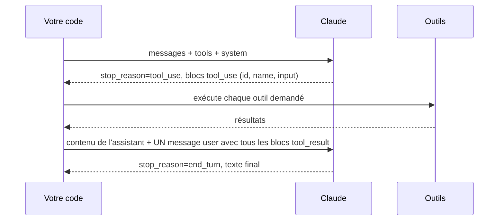

# 04. La boucle d'agent et la conception des outils

## La boucle, pas à pas

Cinq règles qui évitent la plupart des bugs (toutes visibles dans `ex02`) :

1. **Ajoutez le contenu complet de l'assistant**, pas seulement son texte. Les
   identifiants `tool_use` doivent revenir, et les blocs de réflexion
   (thinking) doivent être renvoyés tels quels : les modèles récents rejettent
   un historique dont les tours précédents ont été modifiés.
2. **Renvoyez tous les résultats d'un tour dans un seul message user.** Claude
   peut demander plusieurs outils à la fois (appels parallèles). Répartir les
   résultats sur plusieurs messages lui apprend à ne plus appeler d'outils en parallèle.
3. **Renvoyez les erreurs sous forme de `tool_result` avec `is_error: true`.**
   Le modèle peut corriger son entrée ou changer d'approche. Faire planter la
   boucle gâche l'exécution.
4. **Bornez toujours la boucle** : limite de tours, budget en tokens ou en
   dollars, et détection des appels identiques répétés (`loop.py`).
5. **Vérifiez la raison d'arrêt** avant de lire le contenu.

| `stop_reason` | Signification | Que faire |
|---|---|---|
| `end_turn` | Terminé | Lire le texte |
| `tool_use` | Veut des outils | Les exécuter, boucler |
| `max_tokens` | Coupé | Augmenter `max_tokens` ou streamer ; ne pas analyser une réponse tronquée |
| `pause_turn` | Un long tour d'outil serveur s'est mis en pause | Renvoyer le contenu tel quel pour continuer |
| `refusal` | Refus pour raison de sécurité | Ne pas analyser ; lire `stop_details`, afficher une solution de repli |
| `stop_sequence` | Une séquence d'arrêt définie par vous a été rencontrée | Attendu |

## Concevoir les outils : l'interface agent-ordinateur

Les outils sont l'API que votre agent programme. Soignez-les autant que le prompt.

**Les noms et descriptions sont des prompts.** Dites ce que fait l'outil,
quand l'utiliser, ce qu'il renvoie, et ses limites. Comparez :

| Faible | Solide |
|---|---|
| `get(id)` : « Récupère des données » | `get_order(order_id)` : « Retrouve une commande par son identifiant (format ORD-1234). Renvoie le statut, les articles, les dates, le total et le message cadeau du client. À utiliser avant de répondre à toute question sur une commande précise. » |

**Recommandations**

- **Peu d'outils, qui ont du sens.** Un `search_catalog(query)` vaut mieux que
  `list_books`, `filter_books`, `sort_books`. Moins de choix, moins d'erreurs.
- **Des outils à la forme des tâches, pas de vos tables.** `check_refund_eligibility`
  encode la politique ; le modèle n'a pas à la reconstruire à partir de lignes brutes.
- **Des schémas stricts.** `required`, `enum`, `minimum`/`maximum`,
  `additionalProperties: false`. Mettez `strict: true` sur l'outil pour
  garantir que l'entrée est valide.
- **Des résultats concis et utiles.** Renvoyez ce dont la décision suivante a
  besoin, pas 10 000 lignes. Paginez et tronquez avec une mention (« 20 sur 340 affichés »).
- **Des erreurs exploitables.** « Commande ORD-9999 inconnue. Les identifiants
  ressemblent à ORD-1234. » vaut mieux qu'une pile d'appels.
- **Détrompeurs (poka-yoke).** Rendez les erreurs impossibles : chemins absolus
  plutôt que relatifs, identifiants plutôt que texte libre, montants vérifiés dans le code.
- **Signalez les effets de bord.** Les outils en lecture seule peuvent tourner
  librement ; les outils irréversibles exigent une validation
  (`permission="ask"` dans `loop.py`) et des limites dans le code.

## Les sortes d'outils

| Sorte | Qui exécute | Exemples | Comment les déclarer |
|---|---|---|---|
| **Outils client** | Votre code | `get_order`, `issue_refund` | `name`, `description`, `input_schema` |
| **Outils client définis par Anthropic** | Votre code, schéma connu du modèle | bash, éditeur de texte, computer use, mémoire | `{"type": "bash_20250124", "name": "bash"}` |
| **Outils serveur** | Anthropic | recherche web, lecture web, exécution de code, recherche d'outils | `{"type": "web_search_20260209", "name": "web_search"}` |
| **Outils MCP** | Un serveur MCP | N'importe quoi | Claude Code, Agent SDK, ou le connecteur MCP de l'API |

## Des sorties structurées plutôt que des « astuces d'outils »

Quand vous voulez seulement du JSON en retour, ne créez pas un faux outil :
utilisez `output_config={"format": {"type": "json_schema", "schema": ...}}`
(exemples 01, 03, 05, 06, 07, 10). La réponse respecte le schéma, c'est garanti.

À noter : les modèles les plus récents n'acceptent plus d'imposer un outil
précis via `tool_choice` (`{"type": "tool"}` ou `{"type": "any"}`). Utilisez
`auto`, une consigne explicite, `strict: true`, ou les sorties structurées.

## Réflexion et effort

Les modèles actuels réfléchissent de façon adaptative avant de répondre et
entre les appels d'outils. Vous réglez la profondeur et le coût avec
`output_config.effort` (de `low` à `max`) : bas pour le routage et les workers
simples, élevé ou plus pour la planification et le code difficile. Mesurez sur
votre jeu d'évaluation avant de l'augmenter (chapitre 12).

Suite : [05. Les patterns de workflow](05-workflow-patterns.md).
