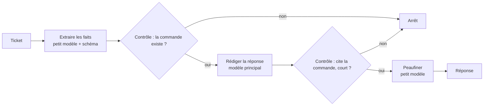
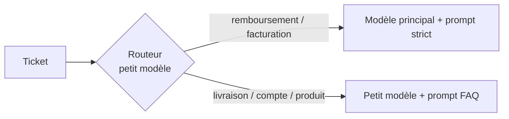
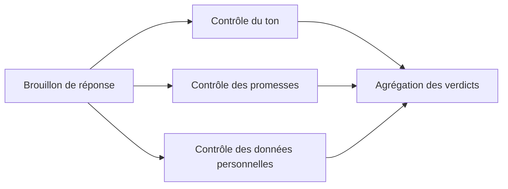
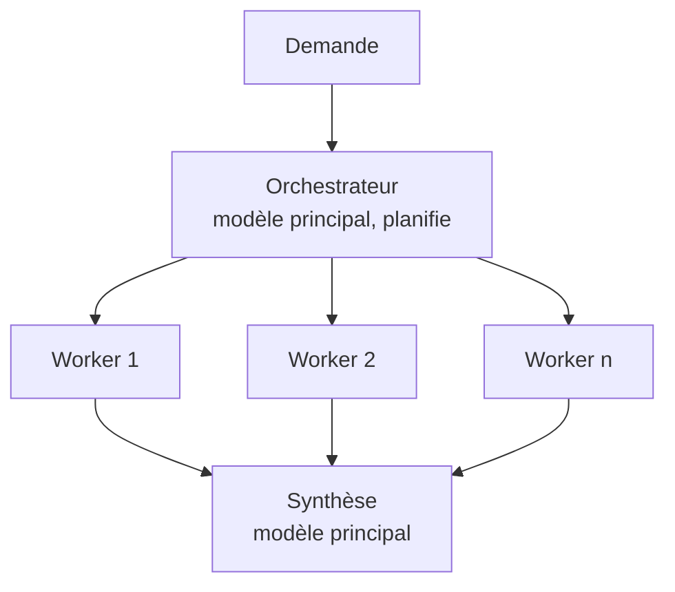
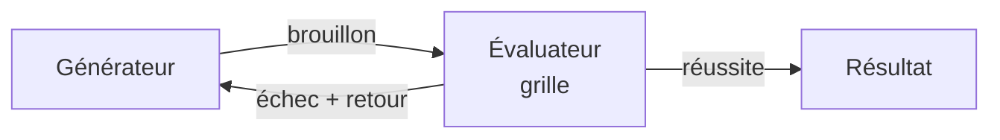

# 05. Les cinq patterns de workflow

Les workflows sont des systèmes agentiques où **votre code** orchestre les
appels au modèle. Ils sont moins chers, plus rapides et plus faciles à tester
que les agents. La plupart des « agents » en production sont en réalité l'un
de ces cinq patterns, ou un mélange.

| Pattern | À utiliser quand | Exemple |
|---|---|---|
| Chaînage de prompts | La tâche se découpe en étapes séquentielles fixes | `ex03` |
| Routage | Les entrées tombent dans des catégories traitées différemment | `ex04` |
| Parallélisation | Des sous-tâches indépendantes, ou plusieurs avis sur une même tâche | `ex05` |
| Orchestrateur-workers | Les sous-tâches dépendent de l'entrée et ne peuvent pas être listées à l'avance | `ex06` |
| Évaluateur-optimiseur | Des critères de qualité clairs, et un retour qui améliore le résultat | `ex07` |

## 1. Chaînage de prompts

Chaque appel fait bien une seule chose, et des **contrôles dans le code**
arrêtent les erreurs entre les étapes. On échange de la latence contre de la précision.

## 2. Routage

Séparation des responsabilités : chaque route a son prompt, ses outils et son
modèle. C'est aussi un levier de coût : le trafic simple part vers le petit
modèle. Évaluez le routeur à part (c'est exactement ce que fait `ex10`).

## 3. Parallélisation

- **Sectionnement** : des sous-tâches indépendantes en parallèle, chacune avec
  un prompt ciblé. Plusieurs contrôles précis valent mieux qu'un seul appel qui vérifie tout.
- **Vote** : la même tâche plusieurs fois, puis majorité ou seuil. Plus de
  confiance sur les questions oui/non à fort enjeu.

## 4. Orchestrateur-workers

L'orchestrateur décide des sous-tâches à l'exécution (plan structuré), les
workers tournent en parallèle avec un **contexte petit et ciblé** (uniquement
leurs données), et l'orchestrateur fusionne. C'est le pont entre workflows et
systèmes multi-agents (chapitre 07).

## 5. Évaluateur-optimiseur

Fonctionne quand on peut écrire les critères, et quand le retour d'un humain
aiderait un rédacteur humain. Utilisez un autre modèle (ou au moins un
contexte neuf) pour l'évaluateur, renvoyez des verdicts structurés, et
plafonnez le nombre de tours.

## Combiner les patterns

Les systèmes réels les composent : un routeur en entrée, une chaîne sur la
route des remboursements, des contrôles parallèles avant l'envoi, un
évaluateur pour les textes marketing. Gardez chaque bloc testable seul, avec
un faux client, comme dans `tests/`.

Suite : [06. L'ingénierie du contexte](06-context-engineering.md).
