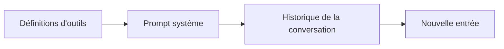

# 06. L'ingénierie du contexte : cache, compaction, mémoire

La fenêtre de contexte est la mémoire de travail de l'agent. Tout ce qu'elle
contient coûte des tokens, ajoute de la latence et se dispute l'attention du
modèle. L'ingénierie du contexte consiste à placer devant le modèle, à chaque
étape, **le plus petit ensemble de tokens à forte valeur**.

## Ce qui entre dans le contexte

Cet ordre compte pour le cache : le contenu stable d'abord, le contenu
variable à la fin.

## Le prompt système

- Écrivez-le comme un brief pour un nouveau collègue brillant : rôle, objectif,
  règles, à quoi ressemble un bon résultat, que faire en cas de doute.
- Soyez précis sur le comportement plutôt que de crier : « Si la commande est
  introuvable, demande l'identifiant » vaut mieux que « NE DEVINE JAMAIS ».
- Structurez avec des sections ou des balises XML, et donnez des exemples des cas délicats.
- Les modèles récents suivent les consignes de près : les prompts écrits pour
  d'anciens modèles sont souvent trop directifs. Supprimez les règles qui ne servent plus.

## Le cache de prompt

L'API peut mettre en cache le début d'une requête (outils, système, premiers
messages). Les tokens en cache coûtent environ un dixième du prix normal en
entrée et sont plus rapides.

- Ajoutez `cache_control={"type": "ephemeral"}` au niveau racine (automatique)
  ou sur des blocs précis (jusqu'à 4 points d'arrêt). Durée de vie par défaut
  5 minutes, 1 heure possible.
- **Tout octet modifié dans le préfixe invalide le cache qui suit.** Ne mettez
  jamais d'horodatage, d'identifiant de requête ou de donnée propre à
  l'utilisateur avant le point d'arrêt ; gardez une liste d'outils déterministe.
- Il existe une taille minimale (quelques milliers de tokens selon le
  modèle) : les petits préfixes ne sont tout simplement pas mis en cache, sans erreur.
- Vérifiez avec `usage.cache_read_input_tokens`. Une valeur nulle sur des
  appels répétés signifie que quelque chose invalide le préfixe.
- Consignes en cours de conversation : les modèles récents acceptent des
  messages `{"role": "system"}` dans `messages`, ce qui évite de modifier le
  prompt système racine mis en cache.

`ex09` et les boucles durcies placent le point d'arrêt du cache après le
prompt système stable et mettent le résumé courant après lui.

## La compaction : garder les longues sessions légères

Quand l'historique grossit, remplacez les anciens tours par un résumé qui
conserve l'essentiel (identifiants, montants, décisions, questions ouvertes).

| Option | Comment | Remarques |
|---|---|---|
| Résumé côté client | Résumer les anciens tours avec un petit modèle, garder les N derniers (`ex09`) | Portable, vous contrôlez ce qui est conservé |
| Compaction côté serveur | `context_management={"edits": [{"type": "compact_20260112"}]}` avec la beta `compact-2026-01-12` | Ajouter `response.content` en entier pour que les blocs de compaction fassent l'aller-retour |
| Édition du contexte | `clear_tool_uses_20250919` efface les anciens résultats d'outils | Les gros résultats d'outils sont souvent le premier poste de coût |
| Claude Code | `/compact` et compaction automatique | Plus `CLAUDE.md` pour ce qui doit survivre |

## La mémoire : ce qui survit entre les sessions

Ne faites pas grossir le prompt indéfiniment. Stockez les faits durables à
l'extérieur et laissez l'agent les lire et les écrire via des outils.

| Mécanisme | Où | Exemple |
|---|---|---|
| Notes derrière des outils | Votre base de données ou des fichiers | `MemoryNotes` de `ex09` |
| Outil mémoire | Outil d'API `memory_20250818`, le stockage est à votre charge | L'agent organise ses propres fichiers |
| `CLAUDE.md` | Claude Code, niveaux projet, utilisateur et entreprise | Conventions, commandes, décisions |
| Memory stores | Managed Agents | Persistants, versionnés, partagés entre sessions |

Écrivez les souvenirs comme des faits avec leur raison, mettez à jour plutôt
que dupliquer, supprimez ce qui s'avère faux, et ne stockez jamais de secrets.

## Le contexte juste à temps

Plutôt que de tout charger d'emblée, donnez à l'agent des outils pour aller
chercher ce dont il a besoin (rechercher, lire un fichier, interroger une
table). C'est ainsi que fonctionne Claude Code : il fait des grep et lit les
fichiers à la demande au lieu de recevoir tout le dépôt. Les sous-agents
(chapitre 07) sont un autre outil : ils explorent dans leur propre contexte et
ne renvoient qu'un résumé.

Suite : [07. Les systèmes multi-agents](07-multi-agent.md).
