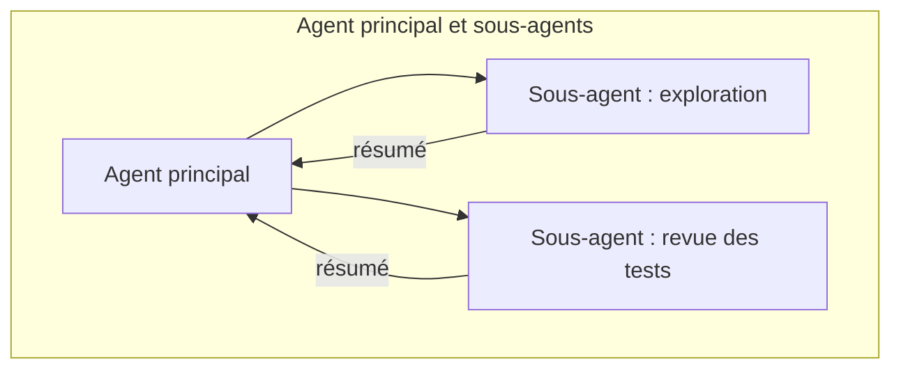

# 07. Les systèmes multi-agents

## Quand plusieurs agents valent mieux qu'un seul

Un seul agent avec de bons outils est la solution par défaut. Passez à
plusieurs agents quand :

- le travail **se découpe en parties indépendantes** exécutables en parallèle
  (recherche sur de nombreuses sources, revue de nombreux fichiers) ;
- **une seule fenêtre de contexte ne suffit pas**, ou le bruit de
  l'exploration noierait la tâche principale ;
- certaines parties demandent **des permissions ou des prompts différents**
  (un explorateur en lecture seule, un rédacteur avec droits d'écriture, un relecteur).

Le prix à payer : les systèmes multi-agents consomment plusieurs fois plus de
tokens, et sont plus difficiles à déboguer et à évaluer. Les tâches qui
exigent un contexte partagé étroit (la plupart des modifications de code)
s'en sortent souvent mieux avec un seul agent.

## Architectures

| Architecture | Description | Dans ce dépôt |
|---|---|---|
| **Orchestrateur-workers (workflow)** | Le code distribue aux workers et fusionne | `ex06` |
| **Agent principal + sous-agents** | L'agent principal décide à l'exécution de déléguer, via un outil Agent | `ex12`, `claude-code/.claude/agents` |
| **Chaîne d'agents** | La sortie de l'agent A est l'entrée de l'agent B (spécification, puis code, puis revue) | Combiner `ex03` avec des agents |
| **Générateur + critique** | L'un produit, l'autre juge | `ex07` |
| **Agents pairs via un protocole** | Des services indépendants qui s'appellent (MCP, HTTP) | `ex11` comme couche d'outils partagée |

## Bien déléguer

L'agent principal doit écrire un **brief**, pas une phrase. Une bonne délégation précise :

1. l'objectif et pourquoi il compte ;
2. le format de sortie attendu (et sa longueur maximale) ;
3. les outils et les sources à utiliser, et ceux à éviter ;
4. les limites : ce qui est hors périmètre, quand s'arrêter.

Le sous-agent renvoie un résultat compact. Le contexte de l'agent principal ne
grossit que de ce résumé, pas de tout ce que le sous-agent a lu.

## Les sous-agents en pratique

- **Claude Code** : des fichiers Markdown dans `.claude/agents/` (nom,
  description, outils, modèle). Claude délègue quand la description
  correspond, ou quand vous le demandez (« utilise le sous-agent code-reviewer »).
- **Agent SDK** : `agents={"test-reviewer": AgentDefinition(...)}` et autoriser l'outil `Agent` (`ex12`).
- **Managed Agents** : une configuration `multiagent` avec une liste de
  sous-agents, ou des workflows dynamiques où l'agent fait travailler de
  nombreux agents par phases.

## Le mélange de modèles

Utilisez le modèle le plus capable là où le jugement compte (agent principal,
planificateur, synthèse finale) et un petit modèle pour le travail ciblé en
volume (workers, lecteurs, classifieurs). Mesurez d'abord : un seul modèle
capable avec un effort plus bas est souvent aussi bon, et plus simple.

Suite : [08. MCP](08-mcp.md).
