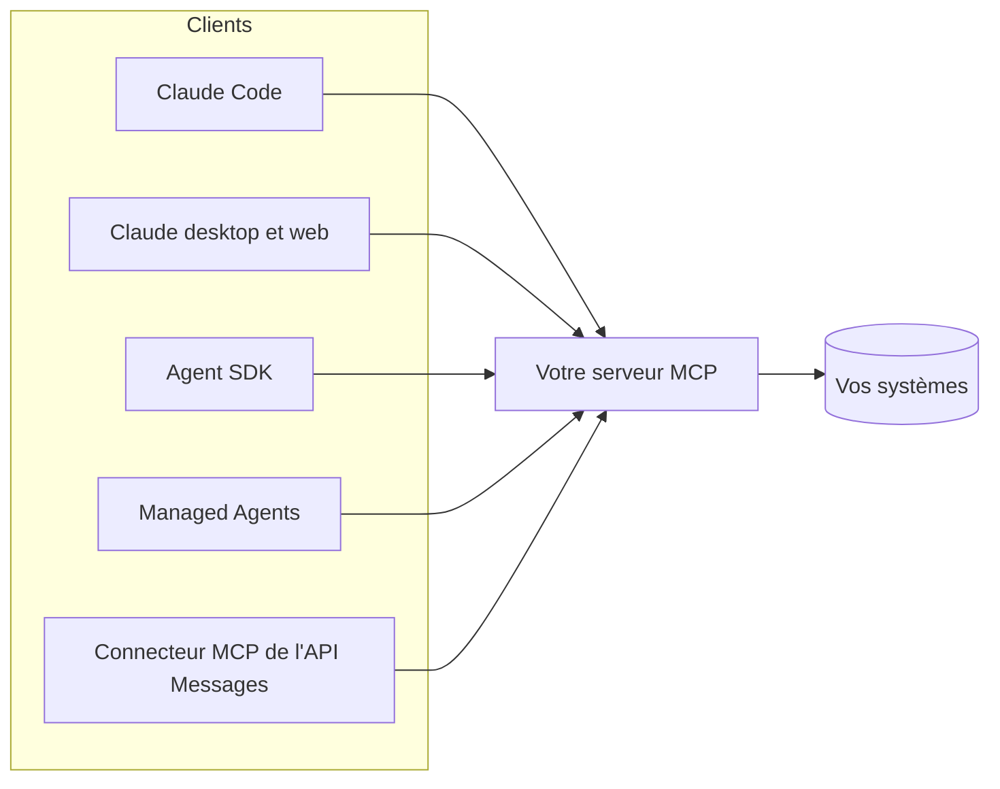

# 08. MCP : le Model Context Protocol

MCP est un protocole ouvert qui permet à n'importe quel agent d'utiliser des
outils, de lire des ressources et de réutiliser des prompts exposés par un
serveur. On écrit l'intégration une fois, on l'utilise depuis tous les clients MCP.



## Les trois primitives

| Primitive | Contrôlée par | Exemple dans `ex11` |
|---|---|---|
| **Outils** | Le modèle décide de les appeler | `get_order`, `search_catalog`, `check_refund_eligibility` |
| **Ressources** | L'application ou l'utilisateur les joint | `paperleaf://policy` |
| **Prompts** | L'utilisateur les choisit (souvent comme commandes slash) | (ajoutez vos propres modèles) |

## Les transports

- **stdio** : le client lance le serveur en processus local. Simple et privé ;
  c'est ce qu'utilise `ex11`.
- **Streamable HTTP** : un serveur distant, partagé par de nombreux
  utilisateurs, en général avec OAuth. Nécessaire pour les connecteurs
  claude.ai, Managed Agents et le connecteur de l'API.

## Utiliser le serveur d'exemple

```bash
# Claude Code
claude mcp add paperleaf -- uv run --directory python python examples/ex11_mcp_server.py
# ou la version TypeScript
claude mcp add paperleaf-ts -- npx tsx typescript/src/examples/11-mcp-server.ts
# puis, dans Claude Code : « La commande ORD-1003 est-elle remboursable ? »
```

Depuis l'Agent SDK, passez-le dans `mcp_servers` (`ex12`). Depuis l'API
Messages, un serveur distant se déclare avec `mcp_servers=[{"type": "url", ...}]`
**et** `tools=[{"type": "mcp_toolset", "mcp_server_name": ...}]`, avec la beta
`mcp-client-2025-11-20`.

## Concevoir un bon serveur

- Les mêmes règles que pour tout outil (chapitre 04) : peu d'outils à la forme
  des tâches, des descriptions solides, des résultats concis, des erreurs exploitables.
- **Moindre privilège** : `ex11` n'expose volontairement aucun outil de
  remboursement. Séparez les serveurs en lecture seule et en écriture, ou
  restreignez les écritures par utilisateur.
- Annotez les outils (`readOnlyHint`, `destructiveHint`) pour que les clients
  sachent ce qui demande une confirmation.
- **Considérez ce qui revient comme non fiable.** Un serveur qui renvoie du
  texte écrit par des tiers (emails, pages web, tickets) est un canal
  d'injection de prompt. N'installez que des serveurs de confiance, et figez leurs versions.
- Testez-le sans modèle : les deux langages ont des clients en mémoire
  (`tests/test_evals_mcp_sdk.py`, `tests/evals-mcp-sdk.test.ts`).

Suite : [09. Claude Code comme plateforme d'agents](09-claude-code.md).
