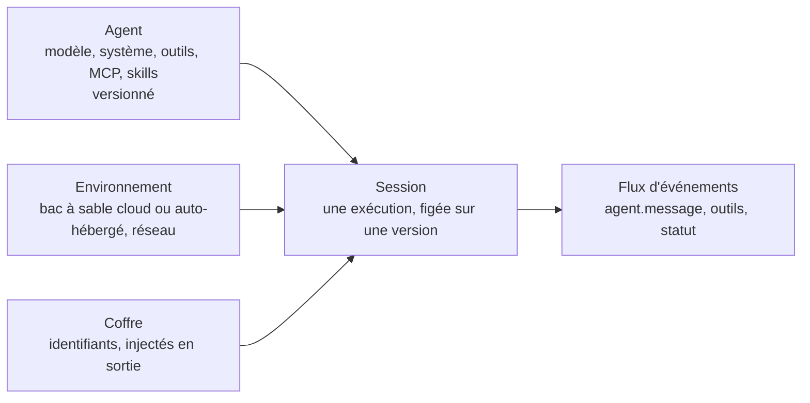

# 10. Claude Agent SDK et Claude Managed Agents

Les deux vous donnent un agent de niveau production sans écrire la boucle. La
différence : **qui héberge les outils**.

| | Agent SDK | Managed Agents |
|---|---|---|
| Ce que c'est | Le harnais de Claude Code en bibliothèque | Un service d'agents hébergé (beta) |
| Langages | Python, TypeScript | Tous (REST), SDK dans tous les langages, CLI `ant` |
| La boucle tourne | Dans votre processus | Chez Anthropic |
| Les outils tournent | Sur votre machine ou votre conteneur | Dans un bac à sable par session hébergé par Anthropic (ou auto-hébergé) |
| État | Sessions reprenables, fichiers sur votre disque | Agents persistés et versionnés, sessions avec flux d'événements, memory stores |
| Idéal pour | Bots de CI, outils internes, agents de code sur votre infrastructure | Agents de longue durée, planifiés ou nombreux en parallèle, sans exploiter de bacs à sable |
| Exemple | `ex12` (Python et TypeScript) | `ex14` (Python et TypeScript) |

## L'essentiel de l'Agent SDK

```python
options = ClaudeAgentOptions(
    cwd="/repo",
    system_prompt="Tu audites des bases de code. Tu ne modifies jamais de fichier.",
    allowed_tools=["Read", "Grep", "Glob", "Agent"],   # ce qui peut s'exécuter sans demander
    disallowed_tools=["Write", "Edit", "Bash"],        # jamais disponible
    max_turns=30, max_budget_usd=1.0,                   # limites dures
    hooks={"PreToolUse": [HookMatcher(matcher="Read", hooks=[block_secrets])]},
    agents={"test-reviewer": AgentDefinition(description=..., prompt=..., tools=[...], model="haiku")},
    mcp_servers={"paperleaf": {"command": "uv", "args": [...]}},
)
async for message in query(prompt="...", options=options):
    ...
```

| Fonction | Comment |
|---|---|
| Tâche ponctuelle | `query(prompt, options)` |
| Multi-tours, interactif | `ClaudeSDKClient` (envoyer, recevoir, interrompre) |
| Reprendre une session | `resume=<session_id>` ou `continue_conversation=True` |
| Outils sur mesure | `@tool` + `create_sdk_mcp_server` (en mémoire), ou n'importe quel serveur MCP |
| Rappel de permission | `can_use_tool=async (name, input, ctx) -> allow / deny` |
| Charger les fichiers du projet | `setting_sources=["project"]` pour utiliser `CLAUDE.md`, skills et sous-agents du dépôt |
| Résultat structuré | `output_format` avec un schéma JSON |
| Isolation | Réglages `sandbox` pour l'outil bash |

Il nécessite la CLI Claude Code installée sur la machine hôte.

## L'essentiel de Managed Agents

Quatre objets :



1. **Créez l'agent une seule fois** (script d'installation, ou `ant apply`
   depuis des fichiers versionnés), conservez son identifiant et sa version.
   Mettez-le à jour en créant une nouvelle version, ne le recréez jamais à chaque exécution.
2. **Créez une session par exécution**, qui référence l'agent et un environnement.
3. **Ouvrez d'abord le flux d'événements**, puis envoyez `user.message` (ou
   `user.define_outcome` pour un livrable unique évalué selon une grille).
4. Lisez les événements jusqu'à `session.status_idle` (sauf s'il vous attend
   avec `requires_action`, par exemple pour confirmer un outil ou fournir le
   résultat d'un outil sur mesure).
5. **Répondez à chaque appel en pause.** Avec la politique de permission
   `auto`, un appel d'outil peut se mettre en pause avec
   `evaluated_permission == "ask"`. Envoyez un `user.tool_confirmation`
   (`allow` ou `deny`) : un appel sans réponse laisse la session en attente
   indéfiniment. Quand personne ne surveille, répondez `deny`, jamais `allow` à tout.

Également disponibles : politiques de permission par outil (`always_allow`,
`always_ask`, `auto`), outils sur mesure exécutés par votre code, serveurs MCP
avec identifiants dans des coffres, memory stores, équipes et workflows
multi-agents, déploiements planifiés (cron), budgets de session en dollars, et
un visualiseur de session dans la Console pour inspecter chaque événement.

`ex14` (Python et TypeScript) montre les phases d'installation et
d'exécution, et ses tests vérifient les trois règles les plus souvent
enfreintes : la version est figée, le flux est ouvert avant l'envoi du
message, et les appels en pause reçoivent une réponse.

Suite : [11. Garde-fous et sécurité](11-guardrails-and-security.md).
